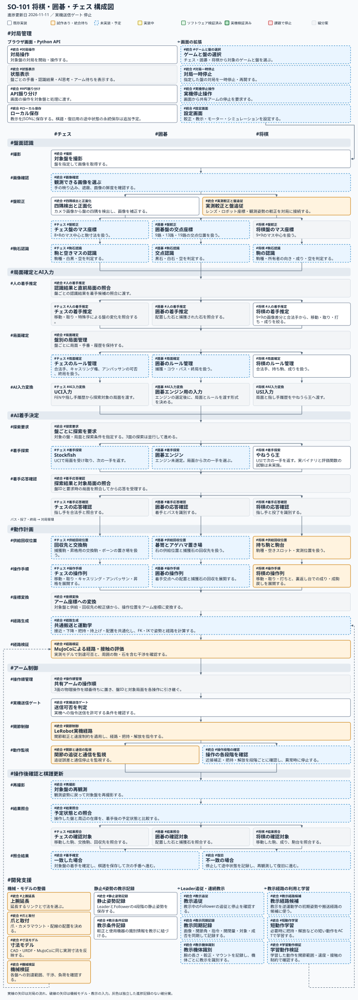

# SO-101 で将棋・囲碁・チェスをやる

## 構成図をすぐ開く

**[タグ付き構成図を拡大](構成図/タグ付き構成図.svg)** · [ブラウザ用HTML](構成図/構成図.html) · [進捗一覧](構成図/構成図.md) · [呼び出しプロンプト](構成図/呼び出しプロンプト.md)

[](構成図/タグ付き構成図.svg)

ローカルで最新の進捗から図を生成して開く（Python標準ライブラリのみ。Macでは `python3`、Windowsでは `py -3` でも実行可）:

```sh
python "構成図/show.py" open
```

チャットからは「**so101_syogi のタグ付き構成図を表示してください。構成図/呼び出しプロンプト.md に従ってください。**」で呼び出す。
色は正本JSONの進捗状態から毎回生成する。進捗更新・同期・確認は [使い方](構成図/README.md) を参照。

## タグ付きプロンプトでAIに作業を依頼する

構成図で対象の箱を選び、**対象・段階・パーツ**の3タグを使ってプロンプトを作る。タグに続けて、編集内容と期待する結果を書く。
対象タグは `#統合`、`#チェス`、`#囲碁`、`#将棋`。ブラウザ用HTMLでは、箱にカーソルを合わせると3タグを確認できる。

```text
#囲碁 #盤面認識 #駒石認識
黒石・白石・空を判定する処理を確認し、9路盤の画像で確認できるようにしてください。
```

AIは作業を受け取ったら [AI作業手順.json](docs/AI作業手順.json) を読み、[タグ付き構成.json](構成図/タグ付き構成.json) のタグを [構成要素と進捗の正本](構成図/構成図.json) に照合してから編集・検証する。作業手順の入口は次のJSON。

```json
{
  "作業手順": "docs/AI作業手順.json",
  "タグ定義": "構成図/タグ付き構成.json",
  "構成要素": "構成図/構成図.json",
  "指示の形式": "#対象 #段階 #パーツ",
  "実行順": ["タグを照合", "対象ファイルを確認", "依頼範囲を編集", "検証", "結果を報告"]
}
```

SO-101（SO-ARM101 系 6 軸アーム）で、実物の将棋・囲碁・チェスを人と対局できるようにするプロジェクトです。
**現状は将棋の開発途中で、実機対局はまだ成立していません。囲碁・チェスは設計段階です。**

- 対象リポジトリ: https://github.com/ichirooo6755/so101_syogi
- 作業元（ローカル）: `~/Documents/ChatGPT/syogi` が将棋の本体、`~/Documents/ChatGPT/so101` が SO-101 本体まわり（カメラ／ロードセル台座・書道）。どちらも本リポジトリに入れました。`nnw`、`kobelco` は別プロジェクトなので入れていません（理由は [docs/repo-map.md](docs/repo-map.md)）。

## ゲームとエンジン

| ゲーム | エンジン | 接続 | 状態 |
| --- | --- | --- | --- |
| 将棋 | やねうら王（YaneuraOu） | USI | 呼出先を変更。実バイナリ・評価関数の導入と試験が必要 |
| 囲碁 | 未選定 | 未選定 | 未実装 |
| チェス | Stockfish | UCI | 採用決定、機能は未実装 |

## 現在地（2026-11-11 時点・引き継ぎ用）

| 項目 | 状態 |
| --- | --- |
| 将棋 GUI・対局ループ（Mac 上） | 実装あり。人の手を画像差分＋合法手で候補化し、やねうら王をUSIで呼ぶ構成へ変更（実バイナリ・評価関数の検証は未実施） |
| 盤の認識 | ArUco マーカー 4 枚で盤四隅を検出し正面化する試作あり。実盤・実照明での精度は未測定 |
| アーム動作計画 | シミュレーション（MuJoCo）で移動・取り・打ち・成りの計画と到達可否を評価済み。実機送信は停止中 |
| 実機（Follower） | USB 未接続の記録が最新。`shogi/app/robot_arm.py` はトルク有効化を拒否する。実機で駒をつかむ／取る／打つ／成るは未検証 |
| 上腕延長部品 | +50 / +58 / +75 / +100 / +125 mm の比較試作（STEP/STL・試算 JSON）。最終寸法は未決定、未印刷のものを含む |
| 手首カメラ | XIAO ESP32S3 Sense 用ファーム（`shogi/firmware/ShogiCamera/`）とマウント試作あり。実機撮影は未試験 |
| 囲碁 | **未着手。** 設計メモだけ [go/README.md](go/README.md) に置いた |
| チェス | **実装予定。** Stockfish/UCIを採用。[chess/README.md](chess/README.md) と構成図に分岐を追加 |

進捗の全体地図は [docs/progress.md](docs/progress.md)。
詳しい現状・次にやることは将棋側の正本 [shogi/README.md](shogi/README.md) と
[shogi/docs/shogi-implementation-plan.md](shogi/docs/shogi-implementation-plan.md)、
SO-101 本体側は [so101/README.md](so101/README.md) が優先です。
本 README と食い違う場合はそちらを正としてください。

## フォルダ構成（ファイルの位置関係）

```
.
├── README.md                  # このファイル（全体の引き継ぎ）
├── docs/
│   ├── progress.md            # SO-101・将棋・囲碁・チェスの進捗一覧（全体の地図）
│   ├── organization-2026-11-10.md  # 2026-11-10 の整理の経緯・選別判断・検証結果
│   ├── repo-map.md            # 元フォルダとの対応・上げなかったものと理由
│   ├── large-artifacts.md     # 大容量で実ファイルを入れていないものの一覧
│   └── board-geometry.md      # 盤面のマス／交点の位置関係（将棋9×9・囲碁19路）
├── shogi/                     # 将棋本体（元 ~/Documents/ChatGPT/syogi）
│   ├── README.md              # 将棋の現状・起動・検証の正本
│   ├── app/                   # GUI・認識・動作計画・実機ゲート
│   ├── cad/                   # 上腕延長・カメラマウントの生成コードと上流 STEP
│   ├── docs/                  # 設計計画・Leader 教示・STEP 検査
│   ├── firmware/ShogiCamera/  # XIAO ESP32S3 Sense 手首カメラ
│   ├── simulation/            # MuJoCo 到達・接触・経路評価（runs/ は含めない）
│   ├── tests/                 # 単体テスト
│   ├── scripts/fetch_upstream.sh  # vendor/ の再取得（やねうら王 等）
│   └── output/                # 延長部品 STEP/STL と試算 JSON、マウント試作
├── go/                        # 囲碁（未着手、設計メモのみ）
│   └── README.md
├── chess/                     # チェス（Stockfish/UCI、設計段階）
│   └── README.md
└── so101/                     # SO-101 本体まわり（元 ~/Documents/ChatGPT/so101）
    ├── README.md              # 本体側の進捗の索引
    ├── output/                # 手首カメラ＋HX711台座 V1–V8、筆保持 V2–V8
    ├── scripts/               # 上記CADの生成・検査スクリプト
    ├── reference/             # 変更前スナップショットと資料
    ├── syodo/                 # 書道（別リポジトリ syodo と同内容の取り込み）
    └── soap_film/             # 薄膜シミュ（履歴として取り込み、代表出力のみ）
```

将棋・囲碁で共有する盤座標の考え方は [docs/board-geometry.md](docs/board-geometry.md) にまとめました。
将棋のマス中心の計算は `shogi/app/board_map.py` が正本です。

## 動かし方（将棋）

```sh
cd shogi
./scripts/fetch_upstream.sh          # vendor/ を取得（既存は変更しない）
python3 ../install_game_engine.py shogi
python3 -m venv .venv
.venv/bin/python -m pip install -r requirements.txt
./将棋GUI.command
```

シミュレーションは Python 3.12 の `.venv-sim` と `shogi/simulation/requirements.txt` が別途必要です。
やねうら王の配置・評価関数・起動方法は [shogi/README.md](shogi/README.md) を参照。
検証も同READMEの「検証と参考資料」を参照。

## GitHub に上げていないもの

- `kobelco/` — 明示的に対象外。別プロジェクト。
- `nnw/` — NW-E507 型 DAP の基板・ファーム。将棋・囲碁と無関係。
- 大容量の再生成できる中間ファイル（書道・将棋の学習 run、FEM の `.vtu/.msh`、薄膜の `state_*.npz`、`.f3d` 中間バックアップ、仮想環境、`vendor/`、`build/`、Wi-Fi 設定、実機較正値）は実ファイルを入れず、生成元と一覧で辿れるようにしています。一覧は [docs/large-artifacts.md](docs/large-artifacts.md)。
- SO-101 本体まわり（台座・書道・薄膜）は 2026-11-10 の追加整理で `so101/` に入れました。経緯は [docs/organization-2026-11-10.md](docs/organization-2026-11-10.md)。

## 課題管理（GitHub Issues）

作業は Issue で追います。引き継ぐ人はまず open Issue と本 README を見てください。

- [#1 実機対局の成立（関節制御・較正・単駒把持）](https://github.com/ichirooo6755/so101_syogi/issues/1)
- [#2 上腕の延長寸法の決定（+58/+75/+100/+125 の比較を実測で決める）](https://github.com/ichirooo6755/so101_syogi/issues/2)
- [#3 盤面の位置関係の実測（盤寸法・マス間隔・駒台スロット・裏返し台）](https://github.com/ichirooo6755/so101_syogi/issues/3)
- [#4 駒台の在庫管理（持ち駒の駒種・空き場所）](https://github.com/ichirooo6755/so101_syogi/issues/4)
- [#5 囲碁の着手（19 路盤の交点座標・石の把持・ルールエンジン選定）](https://github.com/ichirooo6755/so101_syogi/issues/5)

## 注意

- 実機が未準備な状態で成功を保証する記述を増やさないこと。「シミュレーションで浮いた＝実機でできる」ではありません。
- 鍵・Wi-Fi 情報・個人の接続情報をコミットしないこと。
- 大きな学習データ・動画・重みは本リポジトリに入れず、別管理にして参照だけ書くこと。

