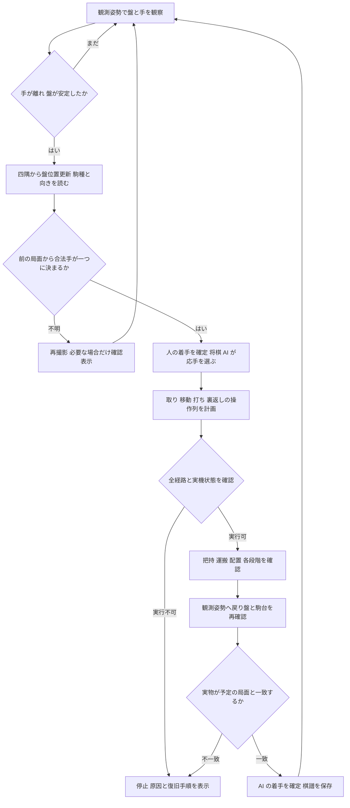
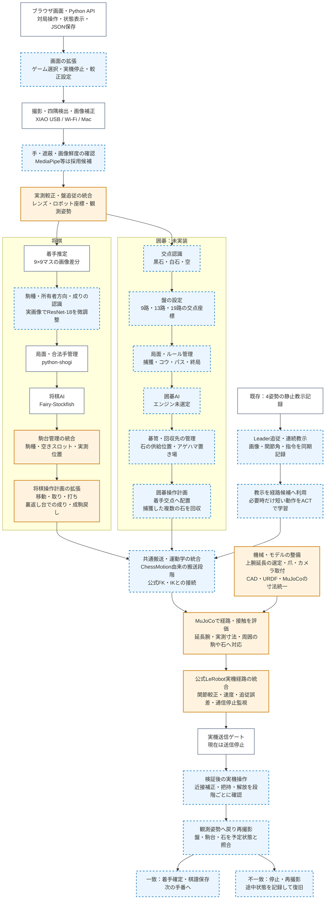

**SO-101 と人が実物の将棋で対局するための設計・実装計画**

策定日：2026-11-06。これは今後の設計判断と検証順序をまとめた計画であり、実機対局の完成報告ではない。現行コード、作業中の延長試算、公開リポジトリのソースと公式資料を確認した。

採用する構成は **公式 LeRobot の関節制御＋既存チェスロボットの駒搬送＋将棋エンジン＋手首カメラによる確認**。アームはリンクを原則 1 本だけ延長する。機械的に届く配置を決め、実測で制御を合わせた後、必要な把持動作に学習を加える。

**完成時の動作と前提**

- 普通の 9×9 将棋盤・将棋駒を使用し、人とロボットが通常の将棋の向きで向かい合う。盤と駒の実寸はこれから測る。
- ロボットが担当する先手・後手は対局ごとに選ぶ。全ての指し手は将棋 AI が選び、到達しやすさで合法手を除外しない。
- 人が指して手を引くと自動検出し、SO-101 が応手する。通常の対局中に「指し終わった」「駒を動かす」ボタンを毎回押す必要はない。
- ロボット自身が移動、相手駒の取り、持ち駒の打ち、成り、取った成駒を表に戻す操作を行う。人側の駒操作は人が行う。
- カメラは手首の XIAO ESP32S3 Sense 1 台。標準グリッパーを出発点とし、必要なら薄い交換式パッドを追加する。
- 盤ずれの初期検証目標は、手と腕が止まっている間の平行移動 ±10 mm・回転 ±3°。実際に合格した範囲だけを仕様にする。動作中に盤を動かしてよい仕様にはしない。
- 認識や把持が不確かなら再観測し、解決しなければ停止して必要な確認だけを表示する。「自動」と「失敗を無視して続ける」を同一に扱わない。

**現在地と、最初に解消する問題**

| 項目 | コード・記録から確認できた状態 | 計画での扱い |
|---|---|---|
| 実機制御 | `app/robot_arm.py` の接続処理は意図的に拒否する。画面の計画成功は実機送信ではない | 公式 API を使う制御経路を独立して立ち上げる |
| 座標・姿勢 | 現行 `board_map.py` は筋方向がロボットから人への方向。通常の対局配置と異なる | 盤の座標定義を統一し、カメラ・駒台・モデル・教示を一緒に移行する |
| 経路 | GUI の `plan_leg` は標準腕を呼び、隣の駒を省いた計画を作る | 延長モデルと現在局面の障害物を使う。既存計画を実機に直結しない |
| 盤ずれ | `board_tracking.py` に較正済みの固定観測姿勢を前提にした処理がある。対局の実機経路には未接続 | 同じ観測姿勢に戻る方式から実測する |
| 教示 | Leader/Follower の静止姿勢を記録する段階 | 連続記録、追従、学習、再生をそれぞれ実装・検証する |
| カメラ | USB CDC で JPEG を取得するファームと GUI 経路がある | XIAO 実機で画質・焦点・遅延・切断復帰を測る |
| 成り | 仮想モデルの移動成功や手首回転だけでは裏面の確認にならない | 裏返しを独立した機械動作として開発する |

したがって「制御ができていない」の原因は、現時点では少なくとも実機経路が未接続であること。モーター故障・較正不良・設計不良のどれかと断定せず、最初の実機試験で切り分ける。

**流用するリポジトリと技術**

| 役割 | 採用・参照先 | 使用する範囲／選定理由 |
|---|---|---|
| ロボットの基準 | [TheRobotStudio/SO-ARM100](https://github.com/TheRobotStudio/SO-ARM100)、[公式 SO-101 手順](https://huggingface.co/docs/lerobot/en/so101) | 公式 CAD・URDF・関節構成・組立を基準に変更箇所を限定する |
| モーター・較正・教示 | [huggingface/lerobot](https://github.com/huggingface/lerobot) | `SO101Follower`、`SO101Leader`、`get_observation`、`send_action`、データ記録を使う。低水準のサーボ通信を作り直さない |
| チェス由来の搬送 | [yanizhang-yz/so-arm101-chess-robot](https://github.com/yanizhang-yz/so-arm101-chess-robot/tree/bb091cb96cf24192d632fee56ef959599b57de29) | `ChessMotion` の接近・段階下降・把持・持ち上げ・配置と `ArmBackend` / `MockArm` を第一候補とする。9×9、平たい駒、駒台、裏返しの橋渡しを追加する |
| FK・IK | [LeRobot RobotKinematics / Placo](https://github.com/huggingface/lerobot/blob/main/src/lerobot/model/kinematics.py) | 公式モデルを使う運動学の基準。候補の残差・関節範囲・経路接触は別途検査する。チェス側の IK は比較用に残す |
| 将棋の局面・指し手 | [python-shogi](https://github.com/The-User-Python/python-shogi)、[Fairy-Stockfish](https://github.com/fairy-stockfish/Fairy-Stockfish) | 既存導入を継続。局面・合法手・USI を再実装せず、Mac で AI の応手を計算する |
| 四隅・カメラ較正 | [OpenCV ArUco](https://docs.opencv.org/4.x/d9/d6a/group__aruco.html)、[calib3d](https://docs.opencv.org/4.x/d9/d0c/group__calib3d.html) | 既存の四隅マーカー、レンズ歪み補正、盤座標変換を利用。カメラが動く観測には外部較正も必要 |
| 人の手の検出 | [MediaPipe Hand Landmarker](https://ai.google.dev/edge/mediapipe/solutions/vision/hand_landmarker/python) と画像の動き | 観測画像に手がある間の着手確定を抑止する候補。実際の画角で評価し、検出なしだけで安全を保証しない |
| 駒認識 | [Torchvision ResNet-18](https://docs.pytorch.org/vision/stable/models/generated/torchvision.models.resnet18.html) | 既存の画像分類器を実際の駒で微調整。正規化した 81 マスと合法手の比較に使う |
| 物理評価 | 既存 [so101-manipulation-eval](https://github.com/FERBIN12/so101-manipulation-eval) と MuJoCo | 現在のシミュレーション資産を修正・継続。実機の幾何、質量、関節限界、駒、爪、カメラを合わせる |
| 必要になった運動学習 | [LeRobot ACT](https://huggingface.co/docs/lerobot/act) | 実機の連続教示から短い把持・解放・裏返しスキルを学習する第一候補 |
| XIAO 映像 | [Seeed 公式カメラ手順](https://wiki.seeedstudio.com/xiao_esp32s3_camera_usage/)、[Espressif CameraWebServer](https://github.com/espressif/arduino-esp32/tree/master/libraries/ESP32/examples/Camera/CameraWebServer) | 現行ファームの上流。USB-C の JPEG 取得を優先し、既存 Wi-Fi を予備経路にする |

チェスロボットの採用候補は Apache-2.0 で、読んだコミットは `bb091cb96cf24192d632fee56ef959599b57de29`。ただし作者の[実測報告](https://github.com/yanizhang-yz/so-arm101-chess-robot/blob/bb091cb96cf24192d632fee56ef959599b57de29/docs/reachability-analysis.md)でも、盤上の姿勢への移動までで、全盤面の確実な実物把持は未達。既定の駒高はチェス用なので流用せず、接続時の設定変更や無条件の home 動作も実機用アダプターで整理する。

比較した候補の扱いは次の通り。

- [BranavanSelvasingham/lerobot-llm-chess](https://github.com/BranavanSelvasingham/lerobot-llm-chess/tree/4493b2beab14af4e16914025ecb72e23a0fe8a50)：較正と搬送の参考。古い LeRobot の全体 fork をそのまま導入しない。確認した `board_pose_estimator.py` の `estimate_from_corners` は単位回転・ゼロ並進を返す仮実装であり、実機の盤姿勢測定に使えない。LLM に指し手やモーター指令を決めさせる構成も採用しない。
- [OpenChessRobot](https://github.com/renchizhhhh/OpenChessRobot)：実物対局、認識信頼度、把持直前の補正、復旧の設計を参考にする。Franka・ROS・別カメラ前提なので全体移植はしない。
- [so101_chess_molmoact2](https://huggingface.co/XvKuoMing/so101_chess_molmoact2)：シミュレーション学習の参考。公開説明は上カメラ＋手首カメラ、28 mm マス、立った円柱状の駒、実機未評価。延長 SO-101・手首 1 台・将棋駒にそのまま使える学習済みモデルではない。
- [ShogiVision](https://github.com/Limuranius/ShogiVision)：81 マスの駒種・向きと履歴から局面を読む構成が参考になる。調査時のツリーにはライセンスファイルが見当たらず、モデル配布先の利用条件も未確認なのでコード・重みの組込みは保留。標準の分類モデルと自分の実物画像で進められる設計にする。
- ユーザー指定の [Shogi Pick Robot](https://www.jijis-blog.com/shogi-pick-robot/)：粗い移動→手先画像で微修正→把持可否判定を参考にする。上カメラと先端カメラを使うクリック式のピック＆ドロップであり、そのまま全自動対局になる構成ではない。

新規に必要なのは「将棋の操作列への変換」「実測較正と既存モジュールの橋渡し」「実行結果を確認する対局管理」が中心。上流はコミット・バージョンを固定し、ライセンスと変更箇所を記録する。今回確認したローカルの実機用 LeRobot は 0.6.1。公式 main の最新コードと混ぜず、使う版で API と依存関係を検証する。

**機械設計：延長寸法を決める手順**

現在の 75 / 100 / 125 mm 上腕延長は比較試作であり、最終寸法をまだ選ばない。通常の対局方向、仮の 330×360×12 mm 盤、下向き把持、限られた IK 初期値で調べたローカル記録は次の通り。

| 上腕の追加長 | 全マスを試した配置中の最大通過数 | その配置の盤中心 X | 判定範囲 |
|---|---:|---:|---|
| +75 mm | 63 / 81 | 285 mm | 静止 IK と選択した接触検査 |
| +100 mm | 74 / 81 | 250 mm | 同上。遠端の角付近と根元中央が残る |
| +125 mm | 73 / 81 | 255 mm | 同上。根元側に失敗が残る |

出典は作業ツリーの `output/upper_arm_extension/opposed_layout_75.json`、`opposed_layout_100_refined.json`、`opposed_layout_125.json`。これは網羅探索でも実機結果でもなく、各長さの優劣を確定しない。慣性は標準腕の近似のままで、支持台・配線・周囲の全ての駒・連続経路・保持力を検証した数ではない。再現用コードと試算の公開セットは実装段階でまとめる。

1. 実際の盤の縦横・厚さ、全駒種の幅・長さ・厚さ、爪先寸法、取付位置、サーボの型式と電源、印刷材を測る。観測できる視野と盤脇の空間も同時に確認する。
2. 公式の両端の軸・ホーン・ねじ穴を保ち、ID2–ID3 間だけを延長する候補と、ID3–ID4 間だけを延長する候補を比較する。最終製作は原則どちらか 1 本。リンク名と ID の対応は現物でも確かめる。
3. 追加長、盤の前後・左右位置、台座高さ、許される爪の傾きをまとめて探索する。長くして遠端が届いても、近端で腕が折り畳まれる候補は落とす。
4. 81 マスの把持・配置に加え、観測姿勢、駒台の全スロット、裏返し台を評価する。駒の向き、実際の隣接駒、持った駒を含め、接近から離脱までの経路で判定する。
5. 最も短く軽い合格候補を選ぶ。延長部品・カメラ・ケーブル・駒の質量と重心をモデルに反映し、肩・肘の必要トルク、たわみ、保持時の温度を評価する。サーボのストールトルクを連続保持可能なトルクとして使わない。
6. STEP / STL / URDF / MuJoCo を同じ寸法から生成し、元の接合部との差分、印刷方向、支持材除去、強度、組付けを確認する。A1 mini に収まらない場合は造形方法を選び直し、単に部品を分割して強度を仮定しない。

標準爪で密集した駒に入れるかは、延長と同じ早い段階で試す。薄い着脱式パッドで解決できなければ、把持部の設計課題として扱う。学習で爪の物理的な干渉は解消できない。

1 本の延長と配置調整で合格解がなければ、そこで設計判断を戻す。台座の移動機構などは次の候補として提示し、届くマスだけで対局できた扱いにはしない。

既存の [XIAO マウント試作](../output/camera_xiao/README.md)を使い、全盤面の視野、近接時の焦点、グリッパーとの遮蔽、USB の抜き差しと全可動域のケーブル逃げで寸法を決める。Fusion MCP が利用できる実装環境では優先し、利用できない間も既存 CadQuery 生成手順で設計を再現できるようにする。

**制御：関節の指令が、実際の爪の位置になるまで**

まず現在の腕で公式 LeRobot の較正・観測・小さな関節指令を確認し、延長後に同じ試験を繰り返す。既存の較正をバックアップして実機の設定と照合し、USB の名前だけで Leader / Follower を識別しない。

`get_observation()` と `send_action()` を実機経路の中心にする。各関節の符号・零点・角度単位・可動範囲と、グリッパーの指令値に対する爪の隙間を実測する。既存の「観測姿勢 1 個から全関節の差を合わせる」処理だけで較正済みとはしない。複数の関節姿勢で、モデルの爪先と実測位置を比較する。

公式 API を呼べば安全や追従が自動的に保証されるわけではない。接続時にサーボ設定・トルクが変わる版があるため、その動作を確認して腕を支持して接続する。1 つのプロセスだけがバスを所有し、公式の目標変化量制限に加えて、時間あたりの速度、加速度、実測角との差、通信停止を監視する。既存 Follower コントローラーの停止・較正確認を共通化し、二重接続を避ける。

SO-101 は手先姿勢に制約がある。位置だけ合った IK 解を採用せず、爪の開閉方向、駒の向き、関節余裕も評価する。現在角を初期値とし、手前・奥で適切な別姿勢も比較する。手首カメラで小さな位置誤差を確認してから短く補正し、再撮影する。

`ChessMotion` が作る搬送段階を、将棋用の高さ・開閉量・向きに合わせて呼ぶ。途中の各姿勢だけでなく、その間の腕・持ち駒の通過領域を確認する。公式 IK の返り値にも位置残差・姿勢残差を検査し、未達の姿勢へ実機を押し続けない。

把持は「閉じる指令を送った」で成功にしない。実測した爪の開度、画像、持ち上げ後の駒の有無を組み合わせて確認する。サーボの位置や負荷表示だけでは、空振り・滑り・適切な把持力を完全には区別できない。

**見る仕組みと自動対局**

四隅の ArUco は盤に固定する。盤と別に置く駒台・裏返し台は、それぞれ位置を測定し識別する。盤がずれたからといって、机に固定した駒台まで一緒に移ったと計算しない。

初期版は再現できる 1 つの観測姿勢に毎回戻り、レンズ較正と実測した盤の対応点から盤面をロボット座標に結び付ける。画像を真上に見せる補正だけではロボット座標の較正にならない。観測姿勢を変えて使う段階では、手首とカメラの位置関係を測り、FK と画像から盤姿勢を求める。較正に使わなかった点で誤差を検証する。駒上面を盤の高さと誤認する視差にも対処する。

手首カメラ 1 台で「全体観測」と「把持直前の近接確認」を切り替える。観測姿勢から四隅と全 81 マスが見え、駒の文字が読めるかを早期判定する。難しい場合は同じカメラによる複数姿勢の走査を比較するが、まずマウント角度・撮影距離・解像度を調整する。近接の焦点が合わない場合も学習前に解決する。

人の着手は、盤位置を合わせた画像差分だけでなく、駒種・所有者方向・表裏を読み、直前の確定局面からの全合法手と照合する。複数の新しいフレームで一致し、手や駒の持ち上げ途中でないことを確認する。安定待ちは 1 秒程度から調整するが、秒数だけで着手確定しない。成り／不成、取り、打ちを明示的に試験する。

将棋の規則は、二歩・打ち歩詰め・行き所のない駒・必須の成り・王手放置・千日手と連続王手・投了なども既存ライブラリの対応範囲を確認して試験する。ロボットの到達失敗を将棋上の終局と混同しない。実行開始直前にも新しい画像で盤と手の状態を再確認する。

AI の指し手は「予定」として保存する。取りで相手駒だけを移した段階なども実行記録に残し、物理的な途中状態を管理する。通信再接続や再試行で同じ駒を二度取りに行かない。盤と駒台の再観測が一致してから局面を確定する。

腕の動作中は手首カメラが全作業域を見続けるわけではない。初期の完成対象は、人がロボットの動作中に手を入れない、立ち会いでの交互対局とする。画面の停止と電源遮断手段を備え、手首カメラだけを全周囲の侵入検知として扱わない。

USB-C は既存の [JPEG 取得ファーム](../firmware/ShogiCamera/README.md)を先に実測する。これは USB Web カメラとして見える UVC とは別の方式。フレームの取得時刻・番号・通信途絶を管理し、古い画像で動作開始しない。遅い場合は停止して撮影する方式を維持し、連続画像が必要な学習は実際の撮影速度に合わせる。

**将棋特有の物理操作**

| 操作 | 実機で行うこと | 確認すること |
|---|---|---|
| 移動 | 駒の実位置へ接近→把持→持上げ→移動→配置 | 元が空、目的地に正しい駒、隣の駒が動いていない |
| 取り | 相手駒を空き駒台スロットへ→自駒を目的地へ | 駒種・表裏・所有者方向・スロットを記録。途中状態から復旧可能 |
| 打ち | 対応する持ち駒の実スロットから空マスへ | 駒台の在庫減少と目的地の駒が一致 |
| 成り | 自駒を裏返し台で反転・再把持して置く | 画像で成駒の面が上を向いたことを確認 |
| 成駒を取る | 捕獲→裏返し台で表へ→駒台 | 表の駒種で登録。次の打ちで使える向きにする |

成りの第一候補は、ロボットが届く場所に置く受動的な裏返し台。形状は試作で選び、駒を支えて一度離し、反転後に取り直す。手首を 180° 回したことだけでは成功としない。成り・成駒取りは必須機能なので、基本把持と並行して早期に試作する。

駒台は当初、重ねない・位置が一意なスロット方式にする。単一の仮置き場では対局を完走できない。ロボット側が持ち得る王以外の最大 38 枚を容量の設計対象にし、全スロットへの到達を確認する。必要な容量が盤脇の到達範囲に収まらなければ、供給・整理機構も設計課題になる。限られた駒台容量の試験を「任意の局面に対応」とは呼ばない。

**学習するもの・しないもの**

将棋の思考は Fairy-Stockfish に任せるので、新たな棋力学習は不要。関節制御・較正・届く範囲は設計と実測で成立させる。学習の対象は次の順序で限定する。

1. **駒種・向き・成りの認識。** 盤補正後の各マスを既存 ResNet-18 で分類する。14 駒種×2 方向＋空の 29 クラスを基準とし、手・遮蔽・低信頼画像は別に棄却する。実物の駒、XIAO、実照明で撮影し、まず各非空クラス 100〜300 枚を収集の目安とする。これは必要枚数の保証ではなく、誤りを見て追加する。連続動画の隣接フレームを学習と評価に分けず、撮影日・配置ごとに分離する。
2. **難しい箇所の教示。** Leader で成功する接近・把持・解放を教える。最初は記録を IK の初期姿勢や候補経路に利用する。数例で直る箇所に、いきなり大きな学習をかけない。物理的に届かないマスは設計へ戻す。
3. **短い動作の模倣学習。** 経路だけでは不安定な場合、LeRobot ACT で把持・解放・裏返しをスキルごとに学習する。まず 1 スキル 50〜100 回程度の成功教示を小規模試験の目安とし、失敗分布に合わせて追加する。対局全体を一度に学習させない。
4. **MuJoCo の利用。** 全マスと盤ずれの到達・接触評価、教示候補の比較を優先する。摩擦・たわみ・ガタ・画像・遅延を実測へ近づけてから模倣学習の補助や残差補正を試す。シミュレーションだけで学習した制御をそのまま実機へ採用しない。

ACT の入力に、どの対象を扱うかが識別できる情報が必要。初期版は IK で目的の駒近傍へ運び、決めた狭い範囲内で同じ短いスキルを使う。任意のマス移動まで学習させるなら目標座標などの条件付けも検証する。ポリシーの出力にも同じ関節・速度・経路制約を適用し、外れたら停止する。

Leader は標準長のままでも関節角の教示に使えるが、延長 Follower の手先位置とは一致しない。Follower の実際の動きを見ながら教える。連続記録には時刻、画像、実測関節角、送った指令、開閉量、盤位置、対象駒、成功・失敗を含める。腕の長さ・較正・マウントを識別子に含め、標準腕の教示や既存チェックポイントを延長腕の実証結果に流用しない。

推論・対局・実機制御は Mac に置く。Korakuen は IP・GPU・VRAM・利用可能な環境が判明した後、同じ小規模学習の時間を測って採用する。CUDA が使えるなら学習候補になるが、Windows というだけで速いとは決めない。遠隔マシンをモーターの時間制約がある制御ループに入れない。

**実施順序と合格条件**

以下の数値は今回提案する開発上の目標で、達成済みの性能ではない。実寸の爪と駒の余裕から、必要ならさらに厳しくする。

| 段階 | 作業・成果物 | 次へ進む条件 |
|---|---|---|
| 0：基準を固定 | 現行変更を保存し、上流 SHA、依存版、実測寸法、関節・盤の座標仕様を記録 | モデル・実機・カメラが同じ軸と単位で説明できる。先手後手も試験 |
| 1：実機の関節制御 | 公式接続、較正照合、小さな指令と実測追従、停止・切断試験 | 全関節で符号・零点・範囲が合い、想定外の飛びや放置された指令がない |
| 2：機械と視野の成立 | 1 リンク延長と配置を選定、CAD・モデル・印刷・組付け、マウントと裏返し台の試作 | 全 81 マス・全駒台・裏返し台に実用姿勢と連続経路がある。視野・保持負荷も成立 |
| 3：座標と単駒 | 複数姿勢の FK 実測、カメラ較正、近接補正、隅・中央・根元で単駒把持 | 非接触位置合わせで初期目標 XY 2 mm・Z 1 mm 以内。把持・解放の反復が成立 |
| 4：全操作 | 全マス、隣接駒あり、取り・打ち・成り・成駒取りを統合 | 各マス pick/place 各 5 回、各特殊操作 30 回を初回評価。成功率と失敗を全記録し、未解決マスなし |
| 5：認識と自動応手 | 実画像で人の着手を検出、操作実行、盤・駒台検証、途中失敗の復旧 | 移動・取り・打ち・成りを含む独立した人の 200 着手で、誤った自動確定 0、自動で正しく確定できる割合 95% 以上を初期目標とする |
| 6：盤ずれ | ±10 mm・±3° の複合した変位を含めて再観測・再計画 | 特に根元と遠端で操作が成立。範囲外、マーカー欠落、残差増大では動かない |
| 7：対局受入 | 先手後手の両方、序中終盤、複数持ち駒、盤ずれを含む対局 | 連続 100 回のロボット操作と、少なくとも 3 局を人の駒操作代行なしで完走。通常手は確認ボタン不要。全特殊操作を別途通過 |

初回評価で 1 回失敗したら永遠に進めないという意味ではなく、原因を分類して修正し、該当試験をやり直す。学習を追加する段階は、その失敗が幾何・機械・較正・認識の問題でないと分かってから選ぶ。連続 100 回や 3 局の成功は開発の区切りであり、故障率や全局面での完全成功の統計的保証ではない。

段階 1 と並行して、オフラインのリポジトリ接続、仮寸法での設計探索、ファームのビルド、認識用データ準備を進められる。段階 2 の最終寸法・段階 3 以降の合否・実機用学習には実物が必要。実機の接続日や再印刷回数が未定なので、現時点で完了日を固定しない。

**GUI と作業の残し方**

対局画面の通常操作は「先手／後手」「対局開始」「一時停止／再開」と、常に見える「停止」。状態は「あなたの番」「手が離れるのを待っています」「考え中」「ロボットが指しています」「確認が必要」で伝える。異常時だけ「盤を確認」「再撮影」など、その場で必要な操作を出す。教示・較正・モーター・シミュレーションは設定画面にまとめる。

GitHub には段階ごとに小さな変更を反映し、README に「実装済み」「ソフトウェアで検証」「実機で検証」「未確認」を分けて書く。各試験にはコード・モデル・較正の識別子、寸法、局面、画像、実測角、成功条件、失敗理由を残す。鍵・Wi-Fi 情報・個人の接続情報は含めず、重い映像・学習データ・重みは必要なものを選んで別管理する。

最初の着手単位は **「公式 API で 1 関節を確実に動かし、実測できる」** と **「1 本だけ延長した候補が全操作域を満たすか判定できる」** の 2 つ。その基準を通した腕に、チェス由来の搬送と将棋の対局処理を接続する。

**将棋・囲碁の共通構成計画（2026-11-11 追記）**

将棋の現行バックエンド、囲碁の追加構成、未実装・未統合の予定機能を
[構成・実装計画JSON](../../docs/shogi-go-architecture-plan.json) にまとめた。
JSONには構成要素、実装状態、接続関係、依存環境、図、実施順序を収録する。
既存の実施順序と合格条件を維持し、ここに示す構成案を接続先の整理に使う。

| 表示 | 状態 |
| --- | --- |
| 白 | 既存のソフトウェア実装。実機での完成を意味しない |
| 橙 | 試作あり。対局ループへの統合や実機検証が未完了 |
| 青破線枠 | 未実装・予定。条件付き機能や技術候補はJSONに条件を記載 |

現在の実機送信ゲートは停止したまま。図の接続は完成を目指す構成であり、
全経路が稼働していることを示さない。囲碁のAI・ルールは未選定で、囲碁は全て未実装。
駒台・盤追従・LeRobot制御は試作と対局統合を区別する。
Leaderの静止4姿勢の記録と、今後の追従・連続記録・学習も区別する。

将棋では画像差分に駒種・方向・成りの認識を加え、実測駒台と裏返し台を操作列へ統合する。
囲碁では交点認識、局面・ルール・AI、碁笥と回収先、複数石の捕獲回収を追加する。
共通側は撮影・座標較正・搬送・経路評価・実機制御・再観測を接続する。
実物の予定状態との一致を確認してから着手と棋譜を確定し、不一致は停止・再撮影・復旧へ進める。

この追記はコード・設定・計画の静的確認による整理であり、起動・テスト・実機試験の完了報告ではない。
