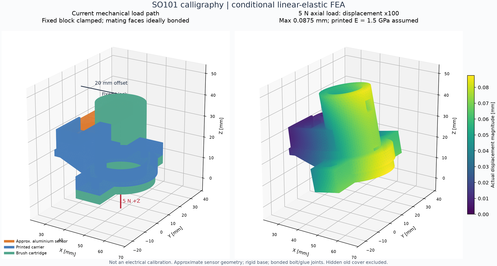

# SO101 書道：ロードセルへの荷重伝達解析

## 結論

解析時点の表示中の構成では、意図しない固定側への接触はなく、仮定した締結が成立する条件で、筆からロードセルへの機械的な荷重経路は成立しています。
ただし、SC616Cの電気出力や測定精度を再現した解析ではありません。「正確な筆圧が読める」ことまでの合格判定ではありません。
元のFusion設計は変更していません。解析用の独立したSTEPコピーだけを使用しました。



## 対象と仮定

- スナップショット取得: 2026-10-21T10:07:45.129708+00:00。`geometry_audit.json`に各部品の形状・位置・体積を記録。
- 現在の本体、上面形状が追加されたキャリア、復元したM3ナットポケット、筆カートリッジを対象にしています。
- 非表示の旧別体上面カバーは取り付けない条件です。旧カバーは本体と約1081.8 mm³干渉するため、現状の本体と同時使用できません。
- 弾性解析対象はセンサ、キャリア、カートリッジの3固体です。本体は剛体として扱い、センサ固定端の y >= 23.462946 mm を完全拘束しました。本体の弾性変形はこの解析に含めていません。
- ロードセルモデルは既存の近似形状です。実物の内部寸法、ゲージ位置、接着層、保護樹脂、配線の剛性は未再現です。
- アルミは E=69,000 MPa、ポアソン比0.33を仮定しました。メーカーの材質証明値ではありません。
- 印刷部品は E=1,500 MPaと3,000 MPa、ポアソン比0.35の等方弾性体を仮定しました。PETG/PLAの実際の造形品に対する保証値ではなく、積層方向、空隙、クリープを含みません。
- ボルト締結面とカートリッジのフランジ面は理想的な固着接合です。ボルトの緩み、接触の開閉、滑り、樹脂のへたりは解析しません。
- ホットグルーが筆とスリーブを十分に保持する仮定で、スリーブ内面へ合力とモーメントが一致する分布荷重を与えました。グルーの剥離・抜けは未検証です。
- 横荷重の作用点は筆軸上 z=-40 mmを仮定しました。実際の筆先がさらに遠い場合、横力によるモーメントも増えます。
- 重力、ロボットの加速度、衝撃、温度、疲労は含みません。

## CAD上の隙間・接触経路

表示中の4固体（本体・キャリア・カートリッジ・センサ）の体積干渉は0です。接触は締結用の端部とフランジに限られています。
拡大した測定部保護領域に本体・キャリアは入り込んでいません。

| 箇所 | 最小隙間 |
| --- | ---: |
| 本体とキャリア | 2.000 mm |
| 本体とカートリッジ | 2.828 mm |
| 本体とセンサ中央変形部 | 1.500 mm |
| キャリアとセンサ中央変形部 | 0.500 mm |

上記はCAD公称寸法です。造形誤差やグルーのはみ出し、張った配線で隙間をつながないことが必要です。

## 荷重ケースと結果

以下は印刷部品E=1.5 GPa・最細メッシュでの結果です。反力は内部断面の節点力から回収し、力とモーメントの両方の釣り合いを検査しました。

| 荷重ケース | センサ内部を通る合力 N | 組立の最大変位 mm | センサ最大変位 mm |
| --- | ---: | ---: | ---: |
| normal_1N | 1.000000 | 0.0175 | 0.0040 |
| normal_5N | 5.000000 | 0.0875 | 0.0199 |
| side_X_0p5N | 0.500000 | 0.0310 | 0.0021 |
| side_Y_0p5N | 0.500000 | 0.0082 | 0.0022 |

「入力1 Nに対しセンサ断面に1 N」は、この理想接合・単一路のモデルの静的な釣り合いの結果です。独立した測定誤差・伝達効率の検証と読み替えることはできません。

剛体本体と小変形の仮定下では、5 N軸荷重に0.5 NのX横荷重が同時に作用した場合も、変位ノルムの和から得た上限は0.1185 mmです。
キャリアと中央変形部の相対変位を保守的に差し引いても、最小隙間0.5 mmに対し0.3624 mm以上残る計算です。
これは接触非線形解析ではなく、接触が発生しないことを変位上限でチェックしたものです。本体の変形・造形誤差を含めた保証ではありません。

## 偏心と横荷重に関する重要な点

筆軸x=50 mm、センサ中心x=30 mmなので、横方向の偏心は20 mmです。
したがって軸方向荷重1 Nで20 Nmm、5 Nで100 Nmmのねじりモーメントがセンサに同時に伝わります。
0.5 Nの横荷重でも中央変形部に応力が発生する結果です。これが実際のブリッジ出力にどれだけ混入するかは、ゲージ配置と補償が不明なので算出していません。

よって現状の結論は「力を伝える機構は成立するが、測定値の正確さは未確定」です。
ロードセルの定格1 kgや、仕様書の四隅誤差の数値だけから、この偏心・筆先高さ・横荷重を含む取り付けで同じ精度が出るとは言えません。

## 数値検証

ソルバーはGmshでメッシュ生成、scikit-femで3次元微小変形線形弾性を組み立て、SciPyの疎行列直接法で求解しています。Fusion標準ソルバーでの解析ではありません。
各ケースで剛体並進のゼロひずみ、剛性行列の対称性、拘束外残差、支持反力、センサ断面の力とモーメントの釣り合いを自動検査しました。
メッシュは全固体が接合された1連結成分で、反転要素はありません。

| メッシュ | 四面体要素数 | 自由度数 | センサ部の指定寸法 mm |
| --- | ---: | ---: | ---: |
| coarse | 79,322 | 56,445 | 0.60 |
| fine | 213,904 | 137,748 | 0.38 |
| refined | 515,007 | 310,395 | 0.28 |

| ケース | 粗メッシュ最大変位 mm | 中メッシュ mm | 細メッシュ mm | 中→細の変化 |
| --- | ---: | ---: | ---: | ---: |
| normal_1N | 0.01387 | 0.01567 | 0.01749 | 10.4% |
| normal_5N | 0.06937 | 0.07837 | 0.08746 | 10.4% |
| side_X_0p5N | 0.02587 | 0.02879 | 0.03099 | 7.1% |
| side_Y_0p5N | 0.00705 | 0.00776 | 0.00821 | 5.6% |

最終2メッシュ間の最大変位の差は最大10.4%です。10%未満の変化という目安も軸荷重ケースでは未達なので、変位量はスクリーニング用の概算にとどめます。厳密な収束証明ではありません。
部品の降伏・強度の合否は判定していません。ボルト周辺の局所応力は理想固着条件に依存し、特に実際のFDM強度と直接比較できません。

## 実物で必要な確認

1. 筆とグルーを付けた状態で、軸方向の既知荷重を複数点加えて校正します。例: 50/100/200 g相当の荷重を、筆先相当位置から正しい軸方向に加えます。校正時のロボット姿勢も記録します。
2. 同じ軸荷重のまま筆先位置と姿勢を変え、読み値の変化を確認します。横荷重だけを与えた場合の出力も確認します。
3. 荷重を増減してヒステリシスとゼロ復帰を測定し、一定荷重で時間変化も確認します。
4. 移動時は筆・キャリアの重量とロボット加速度も信号に入るため、実際の筆圧とは分けて扱います。
5. 中央変形部の隙間、グルーのはみ出し、配線の張り、M3ねじの底付きと緩みを実物で確認します。

## 再実行

```sh
.analysis-venv/bin/python scripts/load_path_fem.py --level coarse
.analysis-venv/bin/python scripts/load_path_fem.py --level fine
.analysis-venv/bin/python scripts/load_path_fem.py --level refined --only-soft
.analysis-venv/bin/python scripts/report_load_path_analysis.py
```

依存パッケージは`../../scripts/requirements-analysis.txt`、元の形状はこのフォルダのSTEP、結果場はVTU、数値一覧はJSONにあります。

## 仕様と方法の出典

- [ユーザー提供のSC616C仕様PDF](../../SC616C-1kg%20load%20cell.pdf): 1 kg定格、アルミ材、4-M3、外形図。ただしゲージ位置や内部詳細、許容ねじりの指定はありません。
- [メーカーのSC616C資料](https://sensor-con.com/products/SC616C-DATASHEET-R2.pdf)
- [HBK: Load application in load cells](https://www.hbkworld.com/en/knowledge/resource-center/articles/load-application-in-load-cells): 荷重導入と寄生荷重の注意。
- [HBK: Installation of Force Transducers](https://cloud.hbkworld.com/en/knowledge/resource-center/articles/installation-of-force-transducers): 偏心、横力、ねじりの影響。
- [Autodesk: Contacts in Simulation studies](https://help.autodesk.com/cloudhelp/ENU/Fusion-Simulate/files/SIM-CONTACT-TYPES.htm): 固着接合と分離接触の区別。
- [Gmsh manual](https://gmsh.info/doc/texinfo/gmsh.html)、[scikit-fem linear elasticity example](https://github.com/kinnala/scikit-fem/blob/master/docs/examples/ex11.py)
