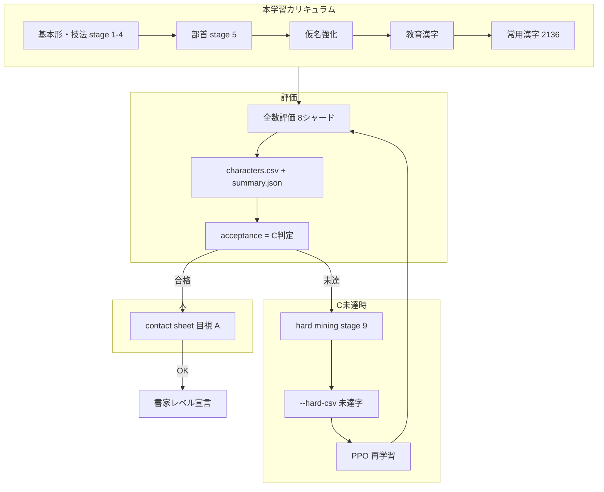

# 用語集と学習プロセス

書道 RL（syodo）の引き継ぎ用メモ。**用語の意味**と**学習が何をしているか**を一覧にしています。  
実行記録の時系列は [training-runs.md](training-runs.md)、並列度は [parallelism-notes.md](parallelism-notes.md)。

---

## 書家レベル（C → A）

| 段階 | 誰が判定 | 意味 |
| --- | --- | --- |
| **C（機械合格）** | スクリプト | 常用漢字 2,136 字すべてが数値ゲートを満たす |
| **A（書家レベル宣言）** | **あなた（目視）** | contact sheet で止め・払い・バランスが書道として許容できる |
| B（書家レビュー） | 後段オプション | 今は使わない |

**重要**: beauty 80 でも C 未達・目視 NG なら「書家レベル」とは書かない。  
設計詳細: [2026-08-16-calligrapher-level-c-to-a-design.md](plans/2026-08-16-calligrapher-level-c-to-a-design.md)

### C ゲート（`acceptance`）一覧

`runs/*/joyo-eval/summary.json` の `acceptance` が **すべて true** で C 合格。

| キー | 条件 |
| --- | --- |
| `all_complete` | 2,136 字すべて完筆 |
| `zero_drips` / `zero_collisions` | 滴下 0・衝突 0 |
| `mean_at_least_75` | 平均美観 ≥ 75 |
| `minimum_at_least_60` | 最低美観 ≥ 60 |
| `mean_line_width_at_least_65` | 平均 line_width ≥ 65 |
| `mean_brushwork_at_least_62` | 平均 brushwork ≥ 62 |
| `mean_harai_finish_at_least_65` | 払い（harai）収筆平均 ≥ 65 |
| `per_char_lw_bw_pass_fraction_at_least_95` | **字ごと**に lw≥65 **かつ** bw≥62 の字が **95%以上** |

---

## 用語集

### 学習・アルゴリズム

| 用語 | 略称 | 意味 |
| --- | --- | --- |
| **PPO** | — | Proximal Policy Optimization。方策（どう動くか）を強化学習する本体。`so101-train-professional` |
| **BC** | Behavior Cloning | 教師軌道（IK＋用筆則）を真似する事前学習。PPO の初期化に使う |
| **IK assist** | — | 逆運動学の名目軌道 + PPO の残差。実際の制御は `--professional` で有効 |
| **timesteps** | step | 環境ステップ数。`n_envs=7` なら 1 rollout で 7×n_steps ずつ増える |
| **n_envs** | — | 並列環境数。16GB Mac では学習 **6〜7** が上限目安 |
| **mps** | — | Apple Silicon GPU。PPO の `device=mps` |
| **SubprocVecEnv** | — | 複数 MuJoCo 環境を別プロセスで並列。BC デモ収集にも使用 |
| **ablation all** | — | 画像お手本 + professional 墨・硯・用筆則をすべて有効 |

### カリキュラム（段階学習）

楷書本学習は **段階（stage）** を順に進める（部首 → 仮名 → 教育 → 常用 など）。

| 用語 | 意味 |
| --- | --- |
| **stage** | カリキュラムの 1 ブロック（例: 部首 05-radicals） |
| **start-stage 9** | **hard-mining 専用段階**から再開（未達字だけ重点） |
| **hard-mining** | 下記。stage 9 の別名としてログに出る |
| **initial-model** | 前 run の `final_model.zip` から权重を引き継ぐ |
| **allow-gate-failure** | 段階ゲート未達でも次へ進む（最終 C で締める） |

### Hard mining（ハードマイニング）

**未達の字だけを重点的に学習する仕組み。**

1. **全数評価**で 2,136 字それぞれの点数が `characters.csv` 一行になる  
2. **hard_mining.py** が「合格ラインを下回った字」を抽出  
   - 例: beauty&lt;60、line_width&lt;65、brushwork&lt;62、完筆失敗、滴下あり  
   - `--hard-csv` で前回評価 CSV を渡す  
3. **stage 9** の学習プール = 未達字 + 固定の回帰セット（良字を忘れない）  
4. PPO 250 万 step などで未達字を叩く  
5. 再評価 → まだ C 未達なら **次ラウンド**（c-loop）

忘れがち: hard mining = **「難しい例を掘って学習に混ぜる」**。C 合格とは別で、**C 未達のときに必ずやる**。

### 評価・成果物

| 用語 | 意味 |
| --- | --- |
| **全数評価** | 常用漢字 2,136 字をモデル 1 本で全部書かせて採点 |
| **シャード** | 全数評価を 8 並列に分割（`evaluate_joyo_shards.py --shards 8`） |
| **characters.csv** | 字ごとの beauty / line_width / brushwork / exemplar_mask_iou 等 |
| **summary.json** | 全体平均・`acceptance`・`technique_means`（とめ/はね/はらい） |
| **contact sheet** | 代表字の書跡 PNG 一覧（**PPO の結果**。IK 比較表と混同しない） |
| **provenance** | `command.txt`, `run.json`, `status.md`, `progress.json` — 再現用 |

### 書道・採点

| 用語 | CSV列など | 意味 |
| --- | --- | --- |
| **beauty** | `beauty_score` | 複数成分の加重平均（0〜100）。高くても形が崩れていることがある |
| **line_width** | `line_width` | 線幅追従（lw） |
| **brushwork** | `brushwork` | 運筆・収筆品質（bw） |
| **glyph_shape** | `glyph_shape` | お手本マスクとの形の一致 |
| **とめ / はね / はらい** | technique_means | 止め・跳ね・払いの収筆スコア。C では **払い平均 ≥ 65** |
| **exemplar_mask_iou** | ログ用 | お手本との IoU。**C ゲートには未使用** |
| **hard-edge 墨** | `InkConfig.stamp_edge` | 楷書向けに縁を硬くした描画（visual-ab で本番化） |

### その他

| 用語 | 意味 |
| --- | --- |
| **c-loop** | C 合格まで hard-mining を最大 4 ラウンド回す自動脚本（`/tmp/run_c_loop.sh`） |
| **ponytail** | `.cursor/rules/` — 最小 diff のエージェント方針（評価・C ゲートは削らない） |
| **visual-ab** | 墨キレ + 美観重みの短い実験 run（Issue #7） |

---

## 学習プロセス（全体）



### 1. 本学習（初回〜常用）

```bash
so101-train-professional --ablation all \
  --timesteps ... --output runs/kaisho-yohitsu-5x ...
```

- 部首 → 仮名 → 教育 → 常用と段階的に PPO + BC  
- 出力: `runs/<name>/final_model.zip`、各 stage サブディレクトリ

### 2. 全数評価

```bash
python scripts/evaluate_joyo_shards.py \
  --model runs/.../final_model.zip \
  --output runs/...-joyo-eval \
  --shards 8 --device cpu
```

- 2,136 字 × 実際の PPO 制御  
- マージ後: `characters.csv`, `summary.json`, `ink/*.png`

### 3. C 判定

`summary.json` → `acceptance` をすべて見る。  
1 つでも false → **hard-mining 必須**（スキップ禁止）。

### 4. Hard-mining 再学習

```bash
so101-train-professional --ablation all \
  --initial-model runs/.../final_model.zip \
  --start-stage 9 \
  --hard-csv runs/...-joyo-eval/characters.csv \
  --timesteps 2500000 ...
```

- 未達字プールだけ（+ 回帰字）を何百万 step 学習  
- **c-loop** はこれを評価 → 判定 → 未達なら次ラウンドを自動繰り返し（最大 4）

### 5. 目視 A

```bash
python scripts/render_ppo_contact_sheet.py runs/...-joyo-eval \
  -o docs/results/...-contact-sheet.png
```

- 機械 C のあと、あなたが止め・払い・バランスを見る  
- メモ例: [2026-08-17-visual-ab-contact-sheet-review.md](results/2026-08-17-visual-ab-contact-sheet-review.md)

---

## c-loop の 1 ラウンド（いまよく動いているもの）

| 順 | 処理 | 出力 |
| --- | --- | --- |
| 1 | hard-mining 学習 | `runs/kaisho-yohitsu-c-rN/` |
| 2 | 全数評価 | `runs/kaisho-yohitsu-c-rN-joyo-eval/` |
| 3 | C 判定 | ログ `runs/c-loop-train.log` |
| 4 | 未達 | N+1 へ（親モデル = 直前 `final_model.zip`） |

スクリプト: `/tmp/run_c_loop.sh`  
PID: `runs/c-loop.pid`  
進捗: `runs/kaisho-yohitsu-c-rN/progress.json`

---

## run フォルダの見方

```
runs/kaisho-yohitsu-c-r2/
├── command.txt      # 実行コマンド全文
├── run.json         # 環境・引数・git
├── status.md        # 目的・親モデル・状態
├── progress.json    # ETA（学習中のみ更新）
├── final_model.zip  # この run の成果モデル
├── hard_mining_pool.json  # 重点字リスト
└── 09-hard-mining/  # stage 9 のログ
```

評価:

```
runs/kaisho-yohitsu-c-r2-joyo-eval/
├── characters.csv   # 2136 行
├── summary.json     # acceptance ← ここで C 判定
├── ink/             # 字ごと PNG
└── shards/          # 8 分割の中間結果
```

---

## いま動いているか・終わったか（確認コマンド）

```bash
# c-loop 生きてるか（r4 まで）
ps -p $(cat runs/c-loop.pid)

# 夜通し（r5+、朝8時まで）
ps -p $(cat runs/overnight.pid)
tail -5 runs/overnight-train.log

# c-loop / 夜通し ログ
tail -20 runs/c-loop-train.log

# 学習 ETA
cat runs/kaisho-yohitsu-c-r4/progress.json

# 評価シャード進捗
ls runs/kaisho-yohitsu-c-r4-joyo-eval/shards/*/final/characters.csv 2>/dev/null | wc -l
```

---

## 現在の状態（2026-08-17 20:40 JST 時点）

| 項目 | 状態 |
| --- | --- |
| **c-loop** | **r4 学習中**（最終ラウンド）→ 終了後 **夜通し r5+** が自動開始 |
| **夜通し** | `scripts/run_overnight_until.sh` — **2026-08-18 08:00** まで r5+。`caffeinate -dims` でアイドル睡眠を抑止。`at` で 23:30〜7:30 毎時起動、`/tmp/run_c_loop.sh` 終了時も `exec` 連鎖 |
| ログ | `runs/c-loop-train.log` / `runs/overnight-train.log` / PID `runs/overnight.pid` |

目視メモは [2026-08-17-visual-ab-contact-sheet-review.md](results/2026-08-17-visual-ab-contact-sheet-review.md) に保存済み。
