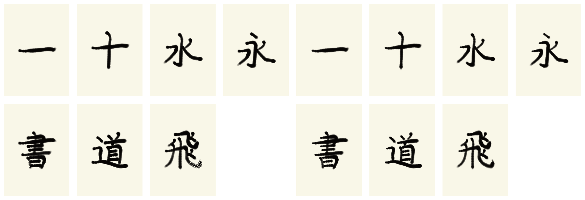

# 連続穂掃引と収筆規則の評価（2026-08-15）

左が従来版、右が今回の改良版です。評価した文字は `一・十・永・水・書・道・飛` の
7字です。従来版で目立った点列状のかすれを、穂束中心の連続掃引で抑えました。

## 評価結果

| 指標 | 従来版 | 改良版 |
| --- | ---: | ---: |
| 完筆 | 7/7 | 7/7 |
| 総合美観平均 | 84.82 | 84.66 |
| 線幅一致 | 22.23 | 40.60 |
| 字形一致 | 96.03 | 96.01 |
| 軌跡一致 | 95.30 | 95.10 |
| 滑らかさ | 95.38 | 95.67 |
| 滴下 | 0 | 0 |
| 衝突 | 0 | 0 |

線幅一致は18.36ポイント改善しました。総合点が横ばいなのは、今回から収筆を単なる
細りではなく、目標の終端線幅・筆圧・速度・抜け方向で採点する厳しい評価へ変更した
ためです。そのため従来版の `brushwork=74.73` と、改良版の `brushwork=54.75` は
同じ尺度の比較ではありません。

厳格評価では、とめ（収筆37.31、線幅22.52）、はね（49.28、61.11）、はらい
（46.16、33.78）で、収筆65・線幅55のカリキュラム合格条件を満たしていません。
完筆しただけで上位課程へ進むことを防ぐため、この不合格をそのまま記録します。

## 保存場所

- 個別の書跡: `docs/results/2026-08-15-brushwork-refined/ink/`
- 教師との比較: `docs/results/2026-08-15-brushwork-refined/comparisons/`
- 一覧画像: `docs/results/2026-08-15-brushwork-refined/contact-sheet.png`
- 旧版との比較: `docs/results/2026-08-15-brushwork-refined/before-after.png`
- 全評価値: `docs/results/2026-08-15-brushwork-refined/summary.json`

この評価は `no-exemplar` です。このMacには正規ライセンスのSモトヤ正楷書5 ProNが
まだ導入されていないため、別フォントを偽の教師として使わず、KanjiVG/AnimCJKの
運筆教師だけで評価しました。Sモトヤ導入後に初めて、完成書跡の最終美観学習を実行
できます。
