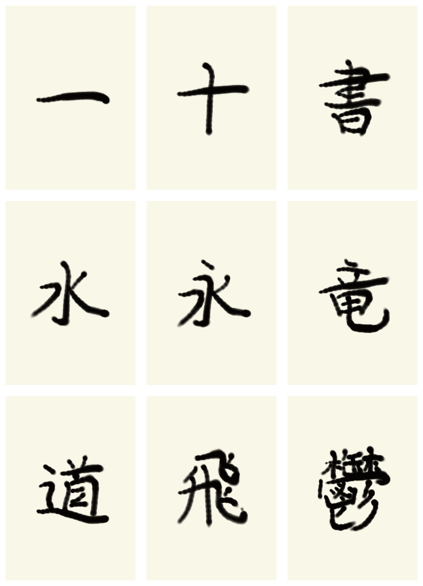
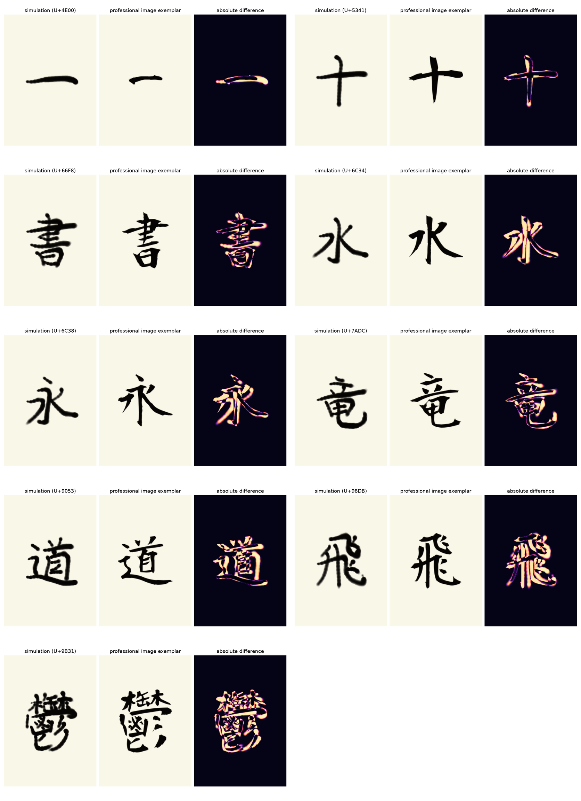

# 画像お手本付きPPOの学習・評価（2026-08-15）

上から `一・十・書・水・永・竜・道・飛・鬱` です。すべて、硯で筆へ墨を含ませ、
硯の縁で余剰墨を落とし、筆を立てて紙へ運び、筆順通りに書く一連のMuJoCo
シミュレーションから生成しました。画像合成で字を描いたものではありません。

## 今回行ったこと

- Aoyagi Kouzanの完成字を16×16の全体画像と、筆先周辺5×5の局所画像へ変換
- 65次元の物理観測へ画像306値を加え、version 3の371次元観測へ更新
- お手本上への着墨と、完成画像誤差の減少を密な報酬へ追加
- KanjiVG/AnimCJKの筆順・画数を保ち、各画を法線方向へ最大8 mmだけ滑らかに補正
- 環境の時間切れを削除し、完筆または物理的危険だけを終了条件化
- 直線的な筆扱い、起筆・送筆・収筆、とめ・はね・はらい、曲線・折れ、部首、
  教育漢字、常用漢字の7段階でbehavior cloningとPPOを実行

PPOは前段の画像条件付きwarm-startを含め累積31,744 stepです。筆物理、含墨モデル、
運筆モデル、画像教師はそれぞれ切り戻して比較できます。

## 実測結果

常用漢字2,136字を6分割で全数実行し、CSV結合時にUnicode単位の重複・欠落がない
ことを検査した固定モデル評価です。

| 指標 | 値 |
| --- | ---: |
| 完筆 | 2,136 / 2,136 |
| 総合美観 平均 / 10%点 / 最低 | 76.57 / 74.58 / 71.00 |
| 字形一致 | 44.21 |
| 画の配置 | 90.40 |
| 画の長さ | 62.23 |
| 画の角度 | 95.68 |
| 線幅 | 38.63 |
| 軌跡 | 94.57 |
| 筆順 | 100.00 |
| 滑らかさ | 95.56 |
| 運筆 | 58.21 |
| 墨質 | 96.66 |
| 含墨 | 75.21 |
| 滴下制御 | 100.00（滴下0） |
| 衝突安全 | 100.00（衝突0） |
| バランス | 94.86 |

代表9字は9/9完筆、平均77.47、最低74.92、滴下0、衝突0でした。
全数評価の所要stepは最短1,079、最長8,595でした。旧4,000-step上限は複雑な文字を
物理失敗ではなく時間切れにしていたため、撤廃が必要だったことも実測で確認できました。

左が実際の墨転写、中央が画像お手本、右が絶対差分です。骨格、筆順、配置、安全性は
安定しました。一方、Aoyagiの鋭い入り・太細差に対してシミュレーションは丸く均一に
なりやすく、字形一致と線幅、特に「とめ」「はらい」の終筆はまだ弱点です。
総合点だけで合格扱いせず、内訳を残す理由がここにあります。

## 現在と今後

- **完了**: 実装、単体・統合テスト、7段階学習、2,136字全数評価、代表字の画像比較
- **現在**: 再現用モデル、全字CSV、集計JSON、書跡画像、報酬曲線を保存済み
- **今後**: 書家の主観評価データ、実機の力覚・遅延較正、毛束を増やした高忠実度モデル、
  紙と墨の材料同定。これらは現在のシミュレーション達成値とは分けて扱います。

生データは同名ディレクトリの`full-characters.csv`、`full-summary.json`、
`representative-characters.csv`、`representative-summary.json`にあります。学習中の報酬は
`reward-start.png`と`reward-joyo.png`、再生可能モデルは
`models/professional-image-v3-ppo.zip`です。
