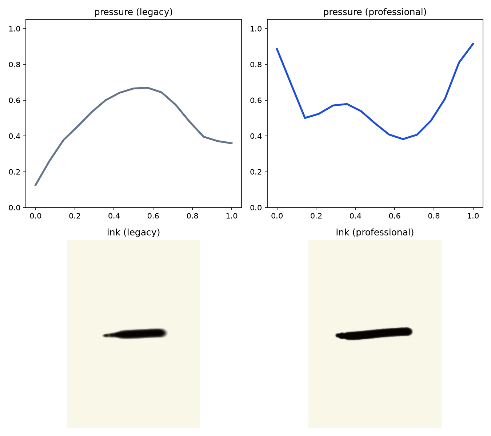
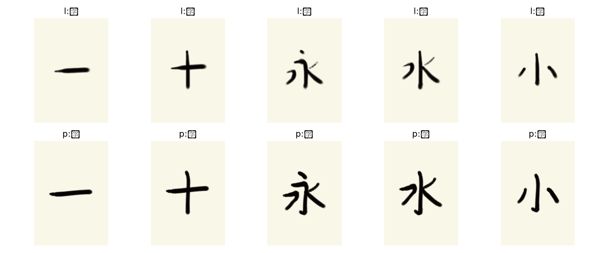

# 楷書用筆則（起筆・送筆・収筆）への切り替え（2026-08-15）



左が従来（AnimCJK外形から筆圧を逆算）、右が楷書用筆則です。横画「一」では
起筆と収筆で筆圧が上がり、送筆で抜ける押し引きが現れます。



上段 legacy、下段 professional。対象は `一・十・永・水・小` です。

## 問題

従来の professional 運筆は、AnimCJK の画ごとの外形線幅サンプルをほぼそのまま
筆圧へ写していたため、横画などが「中央が太く両端が細い」ソーセージ型になり、
楷書の起筆押し・送筆引き・収筆押し／回鋒を再現できていませんでした。

実測（「一」）:

| 区間 | legacy 筆圧 | professional（新）筆圧 |
| --- | ---: | ---: |
| 起筆 | 0.19 | **0.79** |
| 送筆 | **0.64** | 0.48 |
| 収筆 | 0.38 | **0.78** |
| 起終−中のコントラスト | −0.36 | **+0.31** |

## 役割分担

| データ | 担当 |
| --- | --- |
| KanjiVG | 画数・筆順・CJK Strokes 画種ラベル |
| AnimCJK | 日本字形の中心線と、画全体の線幅スケール（中央値1個） |
| `brushwork.py` 用筆則 | 局所筆圧、速度、筆軸ロール、XY逆入・回鋒・転折 |

AnimCJK のサンプル線幅を Z 変位へ直接変換しません。

## 画種分類

KanjiVG の `kvg:type`（CJK Strokes）を次の8家族へ写像します。特定文字への
ハードコードはありません。

| 家族 | 意味 | 代表記号 |
| --- | --- | --- |
| `heng` | 横画 | ㇐ |
| `shu` | 縦画 | ㇑ |
| `pie` | 撇／左払い | ㇒ ㇓ |
| `na` | 捺／右払い | ㇏ |
| `dian` | 点 | ㇔ |
| `ti` | 挑／提 | ㇀ |
| `zhe` | 折／転折 | ㇕ ㇇ ㇋ など |
| `gou` | 鉤／はね | ㇚ ㇁ ㇂ ㇆ ㇈ など |

各家族は起筆・送筆・収筆の筆圧／速度、必要なら逆入・回鋒・転折の XY 微動、
筆軸ロールを持ちます。

## 比較結果（brushwork のみ差し替え）

物理・墨モデルは legacy のまま、運筆だけ切り替えた IK 基準軌道の評価です。

| 字 | legacy 総合 | professional 総合 | legacy brushwork | professional brushwork |
| --- | ---: | ---: | ---: | ---: |
| 一 | 80.66 | **84.55** | 39.33 | **59.07** |
| 十 | 82.54 | **84.24** | 47.05 | **50.84** |
| 永 | 79.89 | **85.37** | 59.47 | 56.63 |
| 水 | 81.63 | **84.37** | 58.72 | 55.45 |
| 小 | 77.72 | **86.39** | 52.69 | **61.85** |

全画の平均筆圧コントラストは −0.32 → +0.03、横画だけ見ると +0.31 です。
払い・鉤は収筆で抜くため平均を押し下げますが、起筆の押しは維持しています。

保存物:

- プロファイル図: `docs/results/2026-08-15-kaisho-yohitsu/profiles/`
- 書跡: `docs/results/2026-08-15-kaisho-yohitsu/ink/`
- 数値: `docs/results/2026-08-15-kaisho-yohitsu/summary.json`

## 短い再学習

```bash
so101-train-professional --ablation no-exemplar \
  --timesteps 2048 --bc-steps 256 --bc-epochs 1 \
  --n-envs 2 --n-steps 256 --batch-size 128 \
  --stage-eval-size 7 --eval-limit 7 --allow-gate-failure \
  --output runs/20260815-kaisho-yohitsu-smoke
```

結果（最終7字、累積約14k PPO step）:

- 完筆 7/7、滴下 0、衝突 0
- 平均美観 83.59、10パーセンタイル 82.30、最低 81.98
- brushwork 成分平均 48.03（短時間学習のため幅一致は未収束）

## 推奨本学習（累積 358,400 PPO step）

```bash
so101-train-professional --ablation no-exemplar \
  --timesteps 50000 --bc-steps 12000 --bc-epochs 3 \
  --n-envs 4 --n-steps 512 --batch-size 256 \
  --device mps --allow-gate-failure \
  --stage-eval-size 32 --eval-limit 64 \
  --output runs/kaisho-yohitsu-full
```

約31分で7段階を完走。最終64字評価:

| 指標 | スモーク (~14k) | 本学習 (~358k) | 第1段階のみ |
| --- | ---: | ---: | ---: |
| 完筆 | 7/7 | **64/64** | 1/1 |
| 総合美観 | 83.59 | 83.50 | **89.04** |
| brushwork | **48.03** | 40.46 | **69.52** |
| line_width | 16.07 | **19.71** | **72.01** |
| 滴下 / 衝突 | 0 / 0 | 0 / 0 | 0 / 0 |

## 画像お手本付き長時間ラン（v1 → 線幅バグ修正 → v2）

接触表の `l:`/`p:` は PPO 結果ではなく IK 比較です。

`runs/kaisho-yohitsu-all-long`（v1、約57分、累積 ~969k step）は完筆96/96・滴下0でしたが、
用筆則の目標線幅を実墨フットプリントより細くしてしまったため `line_width≈0.9` に崩壊しました。

修正: 目標幅を墨転写と同じ `min+(max-min)·√P·opening` 系へ揃え直し。IK基準で
一の線幅スコア 0.08→**55.9**、実測/目標比 **1.03**。

`line_width` は平均の太さだけではなく、画内進捗ごとの実線幅を目標線幅プロファイルへ
補間して全点の誤差を測る。ただし現時点では、起筆/送筆/収筆の太細コントラスト、
払いの先細り勾配、転折部、幅変化の滑らかさ、字内の画間比は独立指標ではない。
これらは [Issue #3](https://github.com/ichirooo6755/syodo/issues/3) で分解して全字評価へ追加する。

続きの学習は `runs/kaisho-yohitsu-all-long-v2`（同じ高負荷・仮名・画像教師、修正後目標）。

## 約5時間本学習 `runs/kaisho-yohitsu-5h`（完了）

設定: `--ablation all`、`all-long` 最終モデルから stage5（部首）開始、仮名900k・
教育/常用へ継続、10並列、MPS。所要約1時間37分、累積約322万 step。

### 段階別

| 段階 | 美観 | line_width | brushwork | 払い収筆 | ゲート未達 |
| --- | ---: | ---: | ---: | ---: | --- |
| 部首 | **79.36** | **69.03** | 57.84 | 57.8 | brushwork, harai_finish |
| 仮名 | 77.30 | 68.49 | 57.39 | — | brushwork, tome_finish |
| 教育 | 78.65 | 67.90 | 58.80 | 55.7 | brushwork, harai_finish |
| 常用 | 78.99 | 67.61 | 58.32 | 62.2 | （allow-gate） |

### 最終96字評価

| 指標 | all-long v1 | **5h 最終** |
| --- | ---: | ---: |
| 完筆 | 96/96 | **96/96** |
| 美観 | 66.67 | **78.98** |
| line_width | ≈0.9 | **68.45**（ゲート達成） |
| brushwork | ≈34 | **57.67**（ゲート62未達） |
| 払い収筆 | — | 58.5 |
| 滴下 / 衝突 | 0 / 0 | **0 / 0** |

線幅バグ修正後の再学習で線幅ゲートは安定達成。運筆はゲートまで約4点、払い収筆が主ボトルネック。

### 継続学習 `runs/kaisho-yohitsu-5x`（実行中・5倍規模）

5h最終モデルから再開。変更点:

- PPO **5倍**（各段階225万、仮名450万）、BCも5倍
- `DummyVecEnv` → **`SubprocVecEnv`（6並列）** でロールアウトをマルチコア化
- BCデモ収集もプロセス並列（Subproc起動前に実行し16GBでのOOMを回避）
- 払い収筆ウィンドウ／`brushwork_quality` 報酬強化を継続

起動: `scripts/run_kaisho_5x.sh`
進捗: `runs/kaisho-yohitsu-5x/progress.json`
