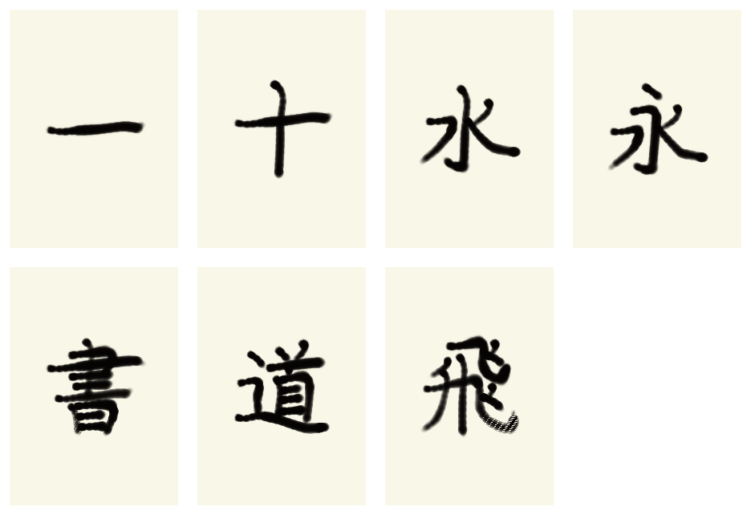

# Motoya-ready brushwork motion smoke result

This is a deterministic seven-character **motion/physics smoke run**, not a
Motoya-trained aesthetic result. The licensed S Motoya Seikaisho 5 ProN font was
not installed on this Mac, so the final-image critic was disabled explicitly
with the `no-exemplar` ablation. Motion still came from KanjiVG stroke metadata
and AnimCJK Japanese medians/widths.

## Result

- characters: 一, 十, 水, 永, 書, 道, 飛
- completion: 7 / 7
- drips: 0
- collisions: 0
- mean engineering score: 84.82 / 100
- trajectory: 95.09; placement: 82.16; length: 77.72; angle: 93.74
- brushwork: 74.73; smoothness: 95.75; line-width match: 22.23

The low width score and visible dry bundle texture on dense characters are
deliberately reported rather than hidden. This result proves the inkstone,
seven-bundle transfer, ordered motion, safety, image saving, and score breakdown
paths. It does not prove Motoya similarity or professional calligraphic beauty;
those gates require the exact licensed font and subsequent PPO training.

Machine-readable results are in `characters.csv` and `summary.json`. Raw ink is
under `ink/`; diagnostic three-panel images are under `comparisons/`. Because the
image exemplar was disabled, their middle panel is labelled `no image exemplar`.
