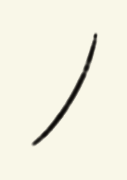
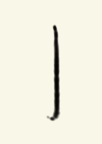
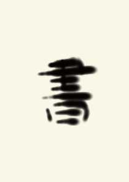

# 弾性筆・墨転写・基本筆法PPOの学習結果

実行日: 2026-08-15

## 結果

弾性穂先、接触力による筆圧、可変線幅、墨量・水分・紙への吸収、かすれ・にじみを現行のMuJoCo/Gymnasium環境へ実装した。KanjiVGの中心線・筆順・画種にAnimCJKの日本語楷書アウトラインを重ね、線幅・筆圧・速度の時系列と、とめ・はね・はらいの収筆プロファイルを生成する。

同じ残差PPO方策を筆法カリキュラムで累積115,200 step学習した。採用モデルは基本7課題を7 / 7完筆し、平均beauty score 75.13、最低67.63だった。

| 課題 | score |
|---|---:|
| 横画・とめ | 67.63 |
| 縦画・とめ | 71.77 |
| 点・とめ | 74.07 |
| 左払い | 77.62 |
| 右払い | 72.06 |
| 折れ・とめ | 79.41 |
| はね | 83.32 |

10 seed、70 episodeのドメインランダム化評価でも70 / 70完筆し、平均74.90、最低66.34だった。最大接触力は5.14 Nで、強制終了閾値8 N未満だった。ランダム化対象は紙面摩擦、関節摩擦・ダンピング、アクチュエータゲイン、穂先剛性、サーボ遅延、初期墨量・含水率である。

## 未学習文字への汎化

基本筆法モデルを追加学習せず、「一・人・小・学・永・書・美・道・風・夢」で評価した。10 / 10完筆、平均64.53、最低53.38だった。「書」は71.17だったが、「学」「道」「夢」のような複雑字では線幅一致と画間配置が弱い。

さらに小学校1〜6年の教育漢字1,026字を全数評価した。全学年で1,026 / 1,026完筆、衝突0、平均65.83、中央値66.72、最低44.40だった。最長級の「臓」は固定2,200 stepだと収筆直前の99.44%で時間切れになったため、文字のwaypoint数に比例する上限へ修正し、2,226 / 2,499 stepで完筆することを再確認した。

「多くの教育漢字を書ける」は満たしたが、平均値と最低値が示すとおり、全字を十分美しく書ける完成モデルとはまだ言えない。特に「愛」「燃」「潟」「識」など複雑字の線幅一致と画間配置は、教育漢字カリキュラムでの追加最適化が必要である。

## 書跡

| 左払い | はね | 未学習の「書」 |
|---|---|---|
|  |  |  |

## 評価方法

0〜100のbeauty scoreは、中心線のChamfer距離と離散Fréchet距離、線幅・筆圧・速度プロファイル、技法別の収筆、文字全体の重心・寸法・傾きを合成した説明可能な工学指標である。完筆だけでは加点せず、筆順に沿った進捗と画ごとの品質を評価する。人間の審美眼の代替ではないため、人による官能評価は別途必要である。

固定した成果物は[models/README.md](../../models/README.md)、数値は[beauty-techniques-evaluation.json](../../models/beauty-techniques-evaluation.json)に記録した。
