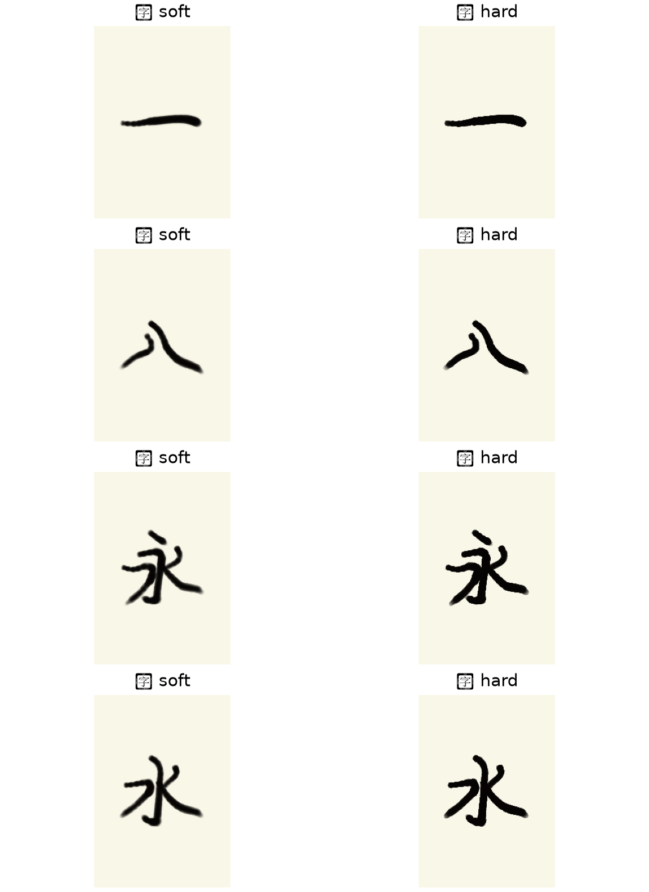
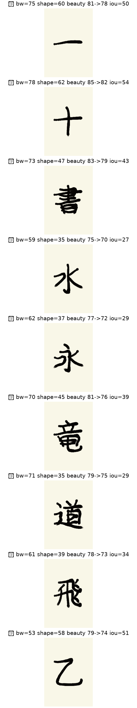

# 見た目改善実験（2026-08-17）

Issue: [#7](https://github.com/ichirooo6755/syodo/issues/7)

## 背景

hard-max 全数評価で beauty≈80 だが `glyph_shape≈45`、contact sheet の `八` `乙` は brushwork≈40。
長い PPO だけでは直らない2点（楕円ぼかし墨・美観重みの歪み）を短い実験で潰す。

## 実験A: 墨 hard-edge

- 変更: `InkConfig.stamp_edge`（`soft` 既定 / `hard` = 硬い楕円コア、ハローほぼカット）
- professional 本番は `stamp_edge=hard`
- IK 基準軌道（PPO なし）で一・八・永・水を比較



再現:

```bash
python scripts/compare_ink_stamp_edge.py \
  --output docs/results/2026-08-17-ink-stamp-edge-compare.png
```

## 実験B: 美観重み + IoU ログ

- `glyph_shape` 0.14→0.19、`brushwork` 0.14→0.19
- `smoothness` 0.06→0.03、`stroke_order` 0.05→0.02、`drip_control` 0.06→0.02
- 評価 CSV / env info に `exemplar_mask_iou`（Cゲート未使用）
- 報酬: `professional_shape` 24、`brushwork_quality` 30

hard-max モデルで代表9字。legacy 重み vs 新重みの beauty 再集計（同一軌跡）:



数値: [2026-08-17-beauty-weights-compare.txt](2026-08-17-beauty-weights-compare.txt)

再現:

```bash
python scripts/compare_beauty_weights.py \
  --model runs/kaisho-yohitsu-5x-hard-max/final_model.zip \
  --output docs/results/2026-08-17-beauty-weights-compare.png
```

## 本番短い再学習（完了）

- 親: `runs/kaisho-yohitsu-c-r1/final_model.zip`
- 出力: `runs/kaisho-yohitsu-visual-ab/final_model.zip`
- 全数: `runs/kaisho-yohitsu-visual-ab-joyo-eval/summary.json`

| 指標 | hard-max | visual-ab |
| --- | ---: | ---: |
| beauty | 79.9 | 76.9 |
| line_width | 69.8 | 75.4 |
| brushwork | 63.5 | 66.9 |
| 払い finish | 56.9 | 55.4 |
| 字単位 lw+bw 両方 | 62.5% | **85.6%** |
| exemplar IoU 平均 | — | 38.2 |

C ゲートは未達（払い・字単位95%）。**目視 A** は [`2026-08-17-visual-ab-contact-sheet.png`](2026-08-17-visual-ab-contact-sheet.png) で止め・払い・八/乙 を確認。書家レベル宣言は C 通過後。

Cループ（`runs/c-loop.pid`）は並行継続。
