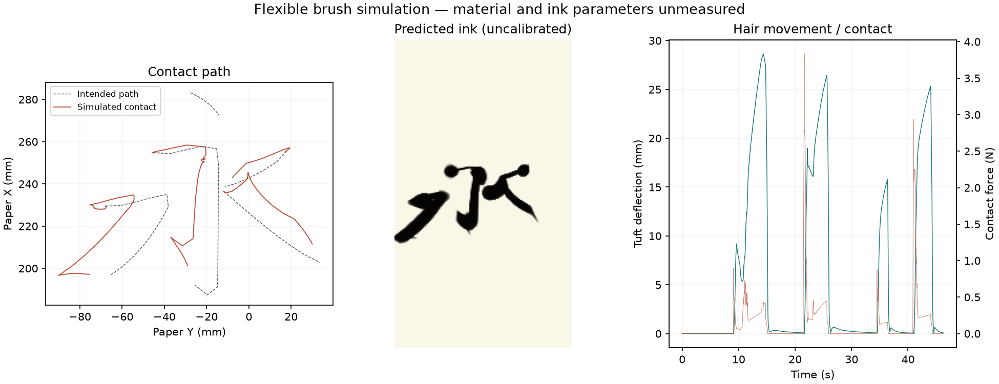
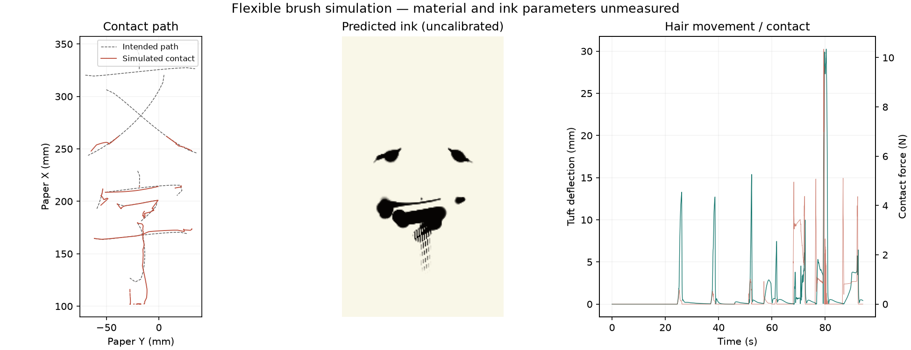

# 実機寸法の筆先再生（2026-09-09）

把持から毛先120 mmを、剛体軸80 mmと3分節の穂40 mmに分けた。保存済み腕指令に対する受動的な曲げ・接触・予測墨跡の診断であり、物性較正、実機書字、画質合格は未達。

| 文字 | 指令FK最大誤差 mm | 接触点XY誤差p90 mm | 書字予定時間の接触不足 | 最大たわみ mm |
| --- | ---: | ---: | ---: | ---: |
| 永 | 0.024 | 24.062 | 4.9% | 28.7 |
| 文字 | 0.081 | 9.395 | 43.9% | 30.3 |
| 学習 | 0.085 | 25.828 | 39.7% | 30.9 |
| 菅原 | 0.107 | 26.443 | 46.1% | 31.2 |

FKは無変形の参照毛先の計算値。接触点の誤差は接触がある時刻だけの集計なので、接触不足と合わせて読む。穂の物性は未同定で、上表は実物の精度ではない。高さ15 mm以上の予定空中区間での接触は全例0秒だった。

[3語の数値とFK検証](words.json)、[永の剛性・摩擦・刻み幅感度](sensitivity.json)を保存した。永の剛性50倍ではp90が1.791 mmになるが、実物に適合する根拠がなく採用していない。刻み幅1 msから0.5 msではp90が24.062から23.344 mmへ変わった。単純な回帰テストの終端差0.2 mm未満を全文字の収束保証として扱わない。

[永の動きGIF](永-brush-motion.gif) / [予測墨跡](永-ink.png)

[文字の予測墨跡](文字-ink.png) / [学習の動き](学習-motion.png) / [学習の予測墨跡](学習-ink.png) / [菅原の動き](菅原-motion.png) / [菅原の予測墨跡](菅原-ink.png)

再生は腕の指令追従を仮定し、サーボ追従遅れ、毛束の割れ、墨の流体を再現しない。接触力を実測筆圧として扱わず、未較正の結果で本書き指令を自動補正しない。次は[4ロードセル計測](../../hardware/force-plate.md)とカメラの観測で物性を同定する。
