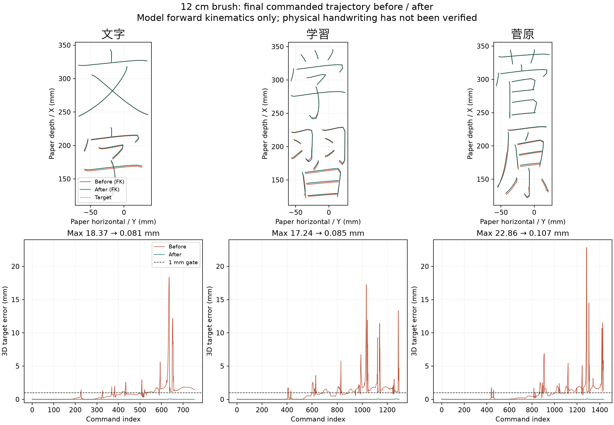

# 実機軌道の改善とopen issue対応（2026-09-08）

把持位置から毛先まで12 cm（筆軸8 cm＋穂4 cm）の実機へ送る軌道を修正した。現在のdeskを使った最終指令のFK検証では、「文字・学習・菅原」の最大位置誤差が17〜23 mmから0.11 mm以下になった。USB機器は開発時点で未接続であり、修正後の紙上の仕上がりは未検証。

## 修正前後

比較元は `f5a2608` に開始時の作業中の実機修正を含めたコード。修正前後で同じdesk、把持→毛先12 cm、字形、文字サイズ、筆圧設定、点数を使用した。当時の`brush_tuft_cm=12`という名称は誤りで、現物の内訳は筆軸8 cm＋穂4 cmだった。NPZに保存された最終関節指令を別の検証スクリプトでFKし、目標との距離を計算した。実機の毛先測定ではない。

| 文字 | 最大位置誤差 mm 前→後 | 接触中の最大XY誤差 mm 前→後 | 最大隣接関節変化 ° 前→後 | 画間の最小高さ mm 前→後 |
| --- | ---: | ---: | ---: | ---: |
| 文字 | 18.374 → 0.081 | 5.580 → 0.081 | 72.777 → 5.000 | 40.355 → 59.999 |
| 学習 | 17.239 → 0.085 | 4.461 → 0.082 | 58.867 → 5.000 | 40.107 → 59.999 |
| 菅原 | 22.857 → 0.107 | 6.870 → 0.107 | 79.927 → 5.000 | 40.200 → 59.999 |

「永」も新しいCLIで生成し、最大位置誤差0.024 mm、最大隣接関節変化2.694°で合格した。4例すべてで位置1 mm以内、筆傾き8°以内、隣接点5°以内、関節端2°以上、空中軌道・画間・最後の上げ・待機の検証に合格。



数値とtrace SHA-256は [before.json](2026-09-08-hardware-path-quality/before.json) / [after.json](2026-09-08-hardware-path-quality/after.json)。trace本体とdeskは各ローカルrunに保存し、個体固有の接続設定は公開しない。

## 変更内容

- 深さ補正を目標座標へ先に入れてから連続するIKを解く。IK後の大きな関節外挿と関節端の丸めを廃止した。画間の60 mm面まで補正が及ばないようにした。
- `hw-write` が保存済み指令を `audit_hardware_trace.py` で独立検証し、失敗時は本書きへ進まない。`--prepare-only` は実機へ接続せず生成・検証・毛先整えの軌道準備までを実行する。
- trace schema 5で全長・筆軸・穂長を分け、旧「穂12 cm」traceや筆圧設定変更後の再利用を拒否する。開ループの実行時には深さを二重補正しない。
- 書字CSVに読み戻し位置、直前の指令、次の指令、直前指令との最大角度差を記録する。切断・中断時も完了分と中断理由を保存する。
- readyだけでなく、姿勢・全長・筆軸長・穂長・紙・硯・関節範囲などを検証する。同じ全長12 cmの表記修正では紙面・関節・筆圧較正を保持し、全長を変えた場合だけ失効させる。
- MuJoCoモデルを剛体軸80 mm＋3分節の穂40 mmに直し、実機用に移動した紙の静的衝突境界も再構築する。`hw-write`は毎回、連続した穂の接触再生を`brush-simulation/`へ保存する。

```bash
./scripts/hw-write 文字 --prepare-only
./scripts/hw-write 学習 --prepare-only
./scripts/hw-write 菅原 --prepare-only
./scripts/hw-write 永 --prepare-only
# 較正が有効な実機を接続し、紙と筆を用意して本書きする
./scripts/hw-write 文字
```

従来の生成先は `runs/hardware-two-character/20260908-145000`、`145006`、`145016`、`145025`。12/8/4 cmへ移行した「永」は `runs/hardware-two-character/20260908-201218` にschema 5の`trace.npz`と`preflight.json`を保存した。

## 4 cm穂の動的再生

新しい再生器は腕の保存済み関節指令を時間補間し、6受動曲げ自由度をリセットせず、紙との接触力・接触点・毛先軌道・たわみ・予測墨跡を保存する。無変形時は把持→穂元79.99999999999999 mm、穂元→毛先40.000000000000014 mm、合計120.0 mmで、IK参照毛先との差は数値誤差内だった。テストでは同じ最終腕姿勢でも進入方向によって毛先位置が0.5 mm以上異なり、1.0 msと0.5 ms刻みの終端差は0.2 mm未満、高さ15 mm以上の空中接触は0秒だった。

一方、物性未較正の既定値で「永」を再生すると接触点の目標ずれはp90 24.1 mm、最大26.1 mm、最大たわみ28.7 mm、接触不足4.9%だった。0.5〜2倍の剛性では結果がほぼ変わらず、50倍ではp90 1.8 mmまで縮むため、実物の剛性同定なしに自動補正すると誤補正になる。既定の本書きでは診断を保存するが、この予測値から関節軌道は変えない。画像と数値は [動的再生結果](2026-09-08-brush-replay/) に固定した。

## issueとの対応

| issue | 対応 | 残る確認 |
| --- | --- | --- |
| [#13](https://github.com/ichirooo6755/syodo/issues/13) 筆傾斜機構 | 現在の30 mm取付機構と6関節IKを検証。剛体軸8 cm＋穂4 cmをモデル化し、筆を−15/+15/+30°傾けながら毛先を保つ回帰テストを追加 | 実機接触中の品質、穂の物性同定 |
| [#14](https://github.com/ichirooo6755/syodo/issues/14) 較正を再生の前提に | 構造・有限値・geometry fingerprint・較正変更時の教示無効化・送信前検証を実装 | 再接続後の実機書字と筆圧確認 |
| [#17](https://github.com/ichirooo6755/syodo/issues/17) glyph_shape / IoU目視 | 既存全常用漢字評価から弱い字と代表字を固定して28字の比較画像・CSVを生成 | 字形品質の改善と書家A判定。未解決 |

[#17の画像・個別指標](2026-09-08-issue17-visual-review/review.md)では、目・旬の横画の欠落、片・工の形の崩れ、語・鬱の密集が残る。保存済み2136字のC判定の再計算は通るが、学習し直した結果ではなく書家A合格でもない。glyph_shape平均59.028、IoU平均55.324。学習モデルと全常用漢字の合格条件は変更していない。

## 初回FK修正時の検証（9/8の記録）

`PYTHONPATH=src .venv/bin/python -m pytest -o addopts='' -q`：普段の `syodo` 作業フォルダへ統合後、385件合格（33.24秒）。実機用のテストfixtureからUSBシリアル・個人の較正ファイルへの依存を除去した。3語の最終FKと姿勢制約、IK後に指令を改変した場合の検出、CLIの検証失敗時停止、筆圧変更後の拒否、位置記録と切断時の記録保持を確認した。

同じ作業フォルダの `./scripts/hw-write 永 --prepare-only` も成功し、`runs/hardware-two-character/20260908-150144/` に保存した。desk・採択モデル・作業中のtraining notesは統合前後でSHA-256が一致した。

当時のdesk fingerprintは `bf996c3c718a2f73cc64980e18b8f1d1a5518e890c5deb9db0b6474c32bcbd0a`。8/−12 mmという高さ設定自体は変更していない。従来は関節端で丸められていたため、修正後に設定どおり到達した際のたわみ・筆圧・墨量を紙上で確認する必要がある。サーボの実位置記録は、その追従誤差と字形の崩れを切り分けるために使う。指令FKの0.11 mmを実機精度として扱わない。

## 12/8/4 cm統合後の検証（9/9）

普段の`syodo`へ統合後、同じ全テストコマンドで **403件合格（43.25秒）**。`./scripts/hw-write 永 --prepare-only`も成功し、`runs/hardware-two-character/20260909-010932/`へschema 5の軌道、FK検証、筆先シミュレーションを保存した。「文字・学習・菅原」も更新後の実機条件で再生成し、上記のFK制約に合格した。

deskは旧ファイルを退避してから全長12 cm・筆軸8 cm・穂4 cmへ移行した。紙面高さ、教示関節、8/−12 mmの圧力補正、readyを保持したことを比較検証した。現在のdesk fingerprintは `3f9a6e1cafd672cd9e26f1a68e1ff51366fd454ad58288d35376c344c706a6e9`。採択モデルと作業中の学習記録を保持し、学習モデルの更新は行っていない。

[4ロードセルの計測基盤](../hardware/force-plate.md)として独立4チャンネルからの合力・荷重中心計算とJSONL解析を実装した。時刻ずれ、飽和、低荷重などを検出する。荷重中心だけで毛先形状を測った扱いにはせず、現段階のデータは学習採用不可と明示する。読み取り基板の実装・実測同定・学習は未実施。

USB接続がなく、この変更後のロボット動作は実施していない。動的再生には大きなたわみと欠画が残る。[保存した画像と個別数値](2026-09-08-brush-replay/README.md)を実機精度や完成判定に置き換えない。
