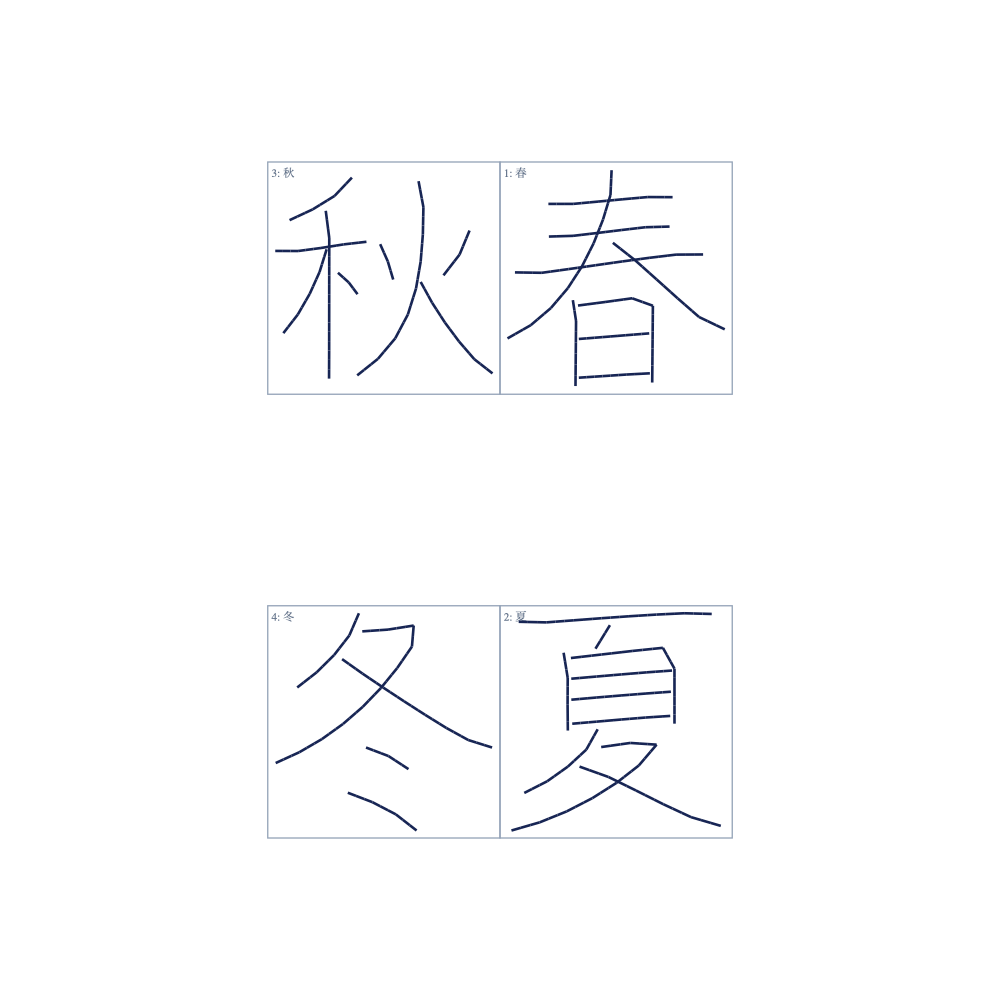

# 1〜4文字と枡を使う書字配置

`./scripts/hw-write 春夏秋冬`で4文字を指定できる。1文字は中央、2文字は縦2段、3〜4文字は右上→右下→左上→左下の2×2配置。3文字では左下が空く。

紙の余白を一度だけ引き、枡に収まる最大の正方形を取る。従来の110 mm上限と1文字の二重余白を廃止した。字形比を保って長辺を広げ、各辺2 mmを筆跡用に残す。大きい候補から2%刻みで80%まで、位置1 mm・筆傾き8°・関節端2°・隣接点5°の条件を維持して検証する。最初に通った候補を採用し、失敗を関節指令の丸めで隠さない。縮小率は`glyph_scale`に保存する。数学的な大域最大の証明ではない。

[SVG](trace.layout.svg) / [枡寸法と充填率](trace.layout.json) / [指令FK検証](preflight.json)

## 現deskでの実行結果

`./scripts/hw-write 春夏秋冬 --prepare-only`が成功。通常作業フォルダの`runs/hardware-two-character/20260909-015626/`に保存した。既存run探索との互換性のため保存親ディレクトリ名は維持している。

| 項目 | 結果 |
| --- | ---: |
| 各枡の辺 | 61.952 mm |
| 文字長辺 / 枡辺 | 93.54%（4文字すべて） |
| 寸法候補の採用率 | 100% |
| 指令FK最大位置誤差 | 0.039 mm |
| 最大筆傾き | 3.590° |
| 最大隣接関節変化 | 4.691° |
| 最小関節端余裕 | 2.000° |
| 最小画間移動高さ | 59.9995 mm |

「菅原」の現deskによる別試行では100%、98%が傾き条件を満たさず、96%で生成成功した。枡そのものは118.378 mm角。到達性による縮小を利用者へ表示する。

全テスト **416件合格（70.88秒）**。1〜4文字の配置、代表6例のIK、枡を使う寸法、枡外・不正セル番号の拒否、左右列への筆圧設定引き継ぎ、通信中断時の記録を検証した。各画の始点も接触として記録し、筆圧監視と接触再生から始点が抜ける問題を修正した。

## 未確認事項

USB未接続で、実機書字は行っていない。筆軸80 mm＋穂40 mmの未較正動的再生では、春夏秋冬の予定書字区間の接触不足52.6%、最大たわみ13.6 mmが残る。指令の配置・FK合格と紙上の仕上がりを区別する。

3〜4文字では奥・手前の開ループ深さと監視上限を左右列で共用する。2文字用閉ループ基準は拒否する。左右での筆圧同定や4ロードセルによる学習を完了した扱いにはしない。実際の墨跡が2 mmの筆跡余白に収まることも未確認。
