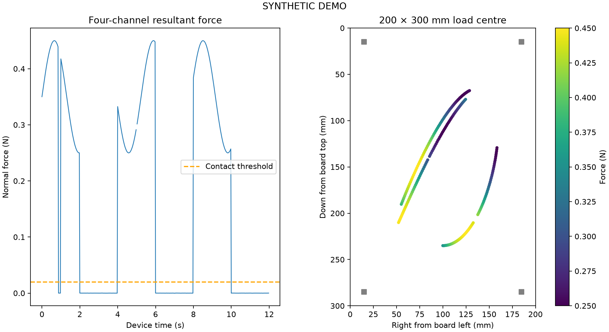

# 200 × 300 mmロードセル板の実装検証

SC616C-1kg×4、厚さ2 mmのアルミ板、HX711×4、Pico 2 W。支持点は現物の中心間隔が未計測で15 mm内側の仮配置。

- `synthetic-force-plate.png` / `synthetic-summary.json` / `synthetic-strokes.csv` は**合成データ**。4セルの異なる符号と感度で静荷重を較正し、未使用の位置で検証。480サンプルの模擬書字で接触抜け5件・欠測1件を検出した。画ごとの筆圧集計を保存。学習採用false。
- `pico-verification.json` は**実機USB確認**。旧ファイルは`runs/force-plate/pico-backup-20260910`へ保存。新しいmain.py/hx711.pyはPico側SHA-256照合で転送を確認。新ファームの20フレーム・sequence・boot ID・時計同期の応答を取得。最短往復時間の半分は約3.05 ms。4台とも未応答で、有効な荷重計測は0件。
- `./scripts/force-plate live --demo --seconds 4` はGUI起動・描画ループ・自動終了に成功した。
- `PYTHONPATH=src .venv/bin/python -m pytest` は446 passed（69.10秒）。既存書字の回帰を含む。追加の小修正後は関連テストを再実行した。

ADCピン波形、実セルの較正、板のたわみ、デジタルフィルタ遅延、取り付けモーメント、実際の筆跡改善は未検証。ロボットは動かしていない。現在のdeskや採用済みモデルは更新していない。

