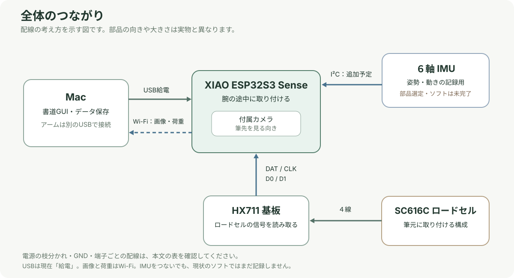

# Mac・カメラ・ロードセル・IMUの接続ガイド

この資料は、SO-101の筆元で使う **SC616C 1 kgロードセル**、腕の途中に付けた **XIAO ESP32S3 Senseとカメラ**、追加予定の **６軸IMU** をMacにつなぐための配線案です。IMUの型番と、実際に使うHX711基板は未確認なので、購入・はんだ付け前に現物の型番と端子表示を照合してください。

> **現在の状態**：カメラと１個のHX711を扱うコードはありますが、実機での配線・同時取得は未検証です。**IMUの読み取り・GUI表示・学習への取り込みはまだ未実装**です。下のIMUのピンは配線予定であり、つなぐだけで表示されるわけではありません。

## 1. 何を用意するか

| 部品 | 数量 | 役割・状態 |
| --- | ---: | --- |
| MacとUSBケーブル | 各1 | XIAOへの給電と、ファームウェア書き込み。USBはデータ通信できるケーブルを使用 |
| XIAO ESP32S3 Sense | 1 | ユーザーが選択済み。付属カメラを腕の途中に取り付け、筆先を見る |
| SC616C 1 kgロードセル | 1 | 筆元の力を測る。既存の取付位置を維持 |
| HX711ロードセル用基板 | 1 | ロードセルの微小な信号を読み取る。**SparkFun SEN-13879と秋月AE-HX711-SIPでは配線が違う** |
| ６軸IMU基板 | 1 | ３軸加速度＋３軸角速度。**3.3 V電源・3.3 VのI²C信号に対応するモジュール**を選ぶ。型番は未決定 |
| 信号線・絶縁材 | 必要分 | 短く柔らかい線を使用。ロードセルや筆の動きを引っ張らない |
| 電圧変換基板 | 基板次第 | 秋月AE-HX711-SIPを使う場合に必要。SparkFun SEN-13879の下記構成では不要 |
| テスター | 1 | 無通電時の短絡・導通確認と、通電時の電圧確認 |

SO-101の腕の制御・電源は既存の接続を使用します。XIAOの3.3 VやUSBからサーボを給電せず、サーボの電源をXIAOの端子に直接つなぎません。

## 2. MacとXIAO、カメラ

| 接続元 | 接続先 | 用途 |
| --- | --- | --- |
| MacのUSB | XIAOのUSB-C | 給電。ファームウェアを書き込むときにも使用 |
| Sense拡張基板のカメラ | 拡張基板のカメラコネクタ | 付属カメラ。カメラ自体をD0〜D5に配線しない |
| XIAOとMac | Wi-Fi | **現在の実装**では画像とロードセル値をWi-Fiで送る |
| MacとSO-101 | 既存のUSB接続 | 腕の位置読み取り・動作。XIAOのUSBとは別 |

USBによる荷重・IMUデータの送信は**未実装**です。MacからUSB給電しても、現在は画像と荷重をWi-Fiで取得します。XIAOに外部5 V電源やバッテリーを併用する場合は、給電経路と逆流防止を別途確認してください。この資料の基本案は**MacのUSBから１系統で給電**します。

USBケーブルは腕に沿わせ、関節を動かしてもプラグや筆元を引っ張らないよう余裕を持たせます。ケーブルの張力はロードセルの値にも影響し得ます。

## 3. XIAOの端子の割り当て

| XIAOの端子 | チップの番号 | 接続先 | 状態 |
| --- | --- | --- | --- |
| USB-C | — | MacのUSB | 給電・書き込み |
| 5V | — | HX711側の5 V電源 | USB給電時の5 V。基板別の表を参照 |
| 3V3 | — | IMUの3.3 V入力、HX711の3.3 V側 | XIAOの3.3 V出力。**5 Vを入れない** |
| GND | — | HX711・IMU・必要時はレベル変換基板のGND | 測定系の共通GND |
| D0 | GPIO1 | HX711のDAT | 現在のファームウェアで設定済み |
| D1 | GPIO2 | HX711のCLK / SCK | 現在のファームウェアで設定済み |
| D4 | GPIO5 | IMUのSDA | **提案・未実装** |
| D5 | GPIO6 | IMUのSCL | **提案・未実装** |

D4/D5はXIAOの外部I²C端子です。カメラ内部で使う別の信号線と混同しません。外部の追加基板を既に使っている場合は、D4/D5が空いていることを実物で確認してください。[Seeedの端子表](https://wiki.seeedstudio.com/ja/xiao_esp32s3_getting_started/)、[カメラ使用ピン](https://wiki.seeedstudio.com/xiao_esp32s3_camera_usage/)

## 4. ロードセルの４線をHX711につなぐ

SC616Cには、励起電源２線と信号２線があります。**手元のSC616C資料には線色の対応が確認できなかったため、色から極性を決めないでください。** 実物の仕様・販売元の資料で `EXC+ / EXC− / SIG+ / SIG−` を確認してから接続します。

| ロードセルの役割 | SparkFun SEN-13879 | 秋月 AE-HX711-SIP |
| --- | --- | --- |
| 励起電源＋ `EXC+ / E+` | `E+` | `CN2-1 AVDD` |
| 励起電源− `EXC− / E−` | `E−` | `CN2-2 GND` |
| 信号＋ `SIG+ / S+` | `A+` | `CN3-2 INPA` |
| 信号− `SIG− / S−` | `A−` | `CN3-1 INNA` |

SparkFun基板に印刷される `RED / BLK / WHT / GRN` は一般的な色の目安です。SC616C実物の線色と一致する保証はありません。シールド線がある場合も、その線が何か確認し、信号線とは混同しません。励起線と信号線を識別できないまま通電しないでください。

ロードセルの中央のくびれ・ゲージ部を固定物や配線で押さえず、固定端と自由端が配線によって橋渡しされないようにします。元の[筆元V8の組立資料](../../output/print_v8/組立部品表.md)も参照してください。

## 5. HX711基板とXIAOの配線

### A. SparkFun SEN-13879を使う場合

既存のカメラ基板台V8は、このSparkFun基板を想定しています。メーカーが示す3.3 Vロジック向けの接続です。**別のHX711基板にそのまま適用しないでください。**

| XIAO | SparkFun SEN-13879 | 役割 |
| --- | --- | --- |
| `5V`（USBの5 V） | `VCC` | HX711側の主電源 |
| `3V3` | `VDD` | HX711側のデジタル電源・信号レベル |
| `GND` | `GND` | 共通GND |
| `D0 / GPIO1` | `DAT` | HX711 → XIAOのデータ |
| `D1 / GPIO2` | `CLK` または `SCK` | XIAO → HX711のクロック |

無通電時に、基板上でVCCとVDDが短絡・ブリッジされていないことを確認し、3.3 V GPIOに5 Vが入らないようにします。実物がSEN-13879であること、基板の版・配線状態も確認してください。VDDを3.3 Vにするこの構成では、DAT/CLK用のレベル変換基板は不要です。[SparkFun接続ガイド](https://learn.sparkfun.com/tutorials/load-cell-amplifier-hx711-breakout-hookup-guide/all)、[V8の基板台](../../output/print_camera_hx711_v8/README_組立と印刷.md)

### B. 秋月 AE-HX711-SIPを使う場合

既存のカメラ基板台V4の配線案はこちらです。秋月の資料では電源入力は**5 V（4.5〜5.5 V）**で、HX711のデジタル側も5 Vです。そのため、XIAOの3.3 V端子とDAT/CLKを直接つながず、下のように**3.3 V ↔ 5 Vの双方向レベル変換**を挟みます。例は既存のV4資料で検討したTXS0108E基板です。

| 接続 | XIAO | TXS0108E基板 | 秋月 AE-HX711-SIP |
| --- | --- | --- | --- |
| 5 V電源 | `5V` | `VB` | `CN1-1 VDD` |
| 3.3 V電源 | `3V3` | `VA`、`OE` | — |
| 共通GND | `GND` | `GND` | `CN1-6 GND` |
| データ | `D0 / GPIO1` | `A1 ↔ B1` | `CN1-2 DAT` |
| クロック | `D1 / GPIO2` | `A2 ↔ B2` | `CN1-3 CLK` |

TXS0108EのA側は3.3 V、B側は5 Vです。`OE`は3.3 V側に接続し、5 Vを入れません。未使用BチャネルのJ3/J4は秋月の説明書に従って処理します。基板の端子の位置は版や向きで変わるため、番号と基板印刷を照合してください。[秋月の仕様書](../../reference/datasheets/AE-HX711-SIP_web_20231219.pdf)、[既存のV4配線資料](../../output/print_camera_hx711_v4/配線と電子部品.md)

**AとBはどちらか１つを選びます。** ２つの表を混ぜたり、両方のHX711を同時につないだりしません。

## 6. ６軸IMUを追加する配線案

IMU基板の型番はまだ決まっていません。まず、**3.3 Vで給電でき、SDA/SCLの信号も3.3 Vで使えるI²Cモジュール**を選び、メーカーの端子表を確認します。センサIC単体と、電源回路付きのモジュールでは端子の意味が異なります。

| XIAO | IMU側の端子 | 内容 |
| --- | --- | --- |
| `3V3` | **3.3 V電源入力** `VIN / VCC / 3V3` 等 | 名称は製品ごとに確認。`3Vo`など電源**出力**端子と間違えない |
| `GND` | `GND` | 共通GND |
| `D4 / GPIO5` | `SDA` | I²Cデータ |
| `D5 / GPIO6` | `SCL` | I²Cクロック |

IMUのI²Cアドレス、SDA/SCLのプルアップの有無と接続電圧、電源電圧、必要なアドレス設定は、選んだ**実際の基板**の説明書で確認します。プルアップが必要な場合も3.3 V側に設け、5 Vへ引き上げません。`INT`は最初の配線案では使わず、未接続です。例として、[AdafruitのMPU-6050基板](https://learn.adafruit.com/mpu6050-6-dof-accelerometer-and-gyro/pinouts)は電源入力`Vin`と電源出力`3Vo`が別です。これは接続の説明例であり、購入するIMUを決めたという意味ではありません。

### IMUの付ける場所

- 第一候補は、**筆元に近く、測りたい方向に対して剛体として一緒に動く部分**です。IMUの軸の向きと、何に固定したかを記録します。
- 腕の途中のカメラ台に取り付けると、その台の動きが測れます。途中に手首や筆元の回転関節があれば、IMUの向きは必ずしも筆の向きと一致しません。必要なら関節角との関係を較正します。
- ロードセルのくびれ、ゲージ、自由端を押さえたり、固定端と自由端を配線や基板でつないだりしないでください。IMU・配線が荷重の逃げ道にならない場所を現物で検討します。
- 既存の筆、ロードセル、腕、カメラを移動・加工する設計変更は、この資料には含まれていません。取付方法・重量・干渉は別途確認が必要です。

## 7. 電源を入れる前からの確認順

1. MacのUSB、XIAOの外部電源、SO-101の電源を外して配線する。使うHX711基板の型番を確認し、上記A/Bの片方だけを使う。
2. ロードセル４線の役割を確認し、基板の端子印刷と照合する。役割が不明なら未接続のままにする。
3. テスターで5 V–GND、3.3 V–GNDの異常な短絡、SparkFun基板のVCC–VDDの意図しない短絡を確認する。抵抗値は回路によって変わるので、導通音だけで良否を断定しない。
4. MacのUSBからXIAOを給電し、XIAOの5 V・3V3と、HX711・IMUの電源端子の電圧を測る。XIAO側の信号線に5 Vが来ないことを確認する。
5. XIAOに対応ファームウェアを書き込み、カメラとHX711をそれぞれ確認する。現在のファームウェアはIMU未対応。
6. 紙から筆を離してロードセルのゼロ点を取り、既知の重りで換算し、**別の重り**で確認する。表示はセンサの計測方向の力で、重力や動きも含む。
7. IMU対応ソフトを追加後、軸の向きと静止時の加速度・角速度を確認し、荷重・腕の関節・画像との時刻合わせと欠測を検証する。
8. 位置を記録し、軌道計算 → 墨なしの空中確認 → 人による確認 → 墨を使う試験の順に進める。ケーブル干渉も毎回確認する。

現時点で、配線・電圧・同時取得・姿勢の補正・学習効果・実書字はいずれも実機未検証です。

## 参考資料

- [書道GUIの操作手順](gui.md)
- [SC616C 1 kgの手元の仕様書](../../SC616C-1kg%20load%20cell.pdf)
- [Seeed XIAO ESP32-S3の端子表](https://wiki.seeedstudio.com/ja/xiao_esp32s3_getting_started/)
- [SparkFun SEN-13879 HX711接続ガイド](https://learn.sparkfun.com/tutorials/load-cell-amplifier-hx711-breakout-hookup-guide/all)
- [秋月AE-HX711-SIPの手元の仕様書](../../reference/datasheets/AE-HX711-SIP_web_20231219.pdf)
- [Adafruit MPU-6050基板の端子の例](https://learn.adafruit.com/mpu6050-6-dof-accelerometer-and-gyro/pinouts)
